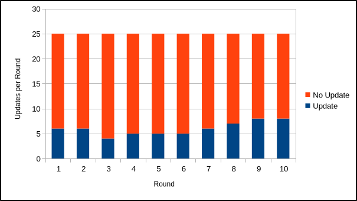

# `did:btcr2` - Data Set 1

## Basic dataset information

**Number of DIDs:** 25

**Number of update rounds:** 10

**Total beacon types:** {SMTBeacon=25, SingletonBeacon=75, CASBeacon=25}

**Total cohort types and sizes:**

| Cohort                              | Type  | Size |
|:------------------------------------|:-----:|:-----|
| `cohort-mutinynet-cas-5*914489003`  | `cas` | 5    |
| `cohort-mutinynet-smt-4*1313926177` | `smt` | 4    |
| `cohort-mutinynet-smt-5*1558620337` | `smt` | 5    |
| `cohort-mutinynet-smt-5*261042241`  | `smt` | 5    |
| `cohort-mutinynet-cas-3*1281328863` | `cas` | 3    |
| `cohort-mutinynet-cas-7*1215244637` | `cas` | 7    |
| `cohort-mutinynet-smt-5*285767441`  | `smt` | 5    |
| `cohort-mutinynet-smt-6*1459988450` | `smt` | 6    |
| `cohort-mutinynet-cas-9*729704740`  | `cas` | 9    |
| `cohort-mutinynet-cas-1*1337910826` | `cas` | 1    |

## Updates

**Update probabilities per DID per round:** 0.25 (true), 1.0 (false)

**Actual update count:** 60

**Actual update counts by round:** 6,6,4,5,5,5,6,7,8,8



## Updates: Beacons, Operations, Sizes

**Beacon type probabilities per update:** 0.25 (SMTBeacon), 1.0 (CASBeacon)

**Actual updates by beacon types:** {SingletonBeacon=0, SMTBeacon=19, CASBeacon=41}


**Actual update operations:** {add=48, replace=13, remove=4}


**Actual update sizes:** 1076,928,1077,956,1026,1146,931,931,1073,1072,987,932,1077,1077,927,883,932,883,928,1026,928,1073,1094,932,928,1025,931,928,1073,1077,1124,928,1073,1073,1073,928,1026,883,932,932,952,883,1073,928,1073,932,883,932,1073,1073,1073,1073,1026,1073,928,1073,987,1077,1093,1073


## Updates: Details

**Actual updates by round by DID:**

```
did:btcr2:x1qh6zcyn4cujckjvw3e2xavq0tmqekakc7ztvan3zlcnn3nn0arp0gqxhxhs -> . . . . O . . . O O (3)
did:btcr2:x1qhyknkc0mgnzvmd0thrervyzznra3g4aj0cwx94qjce24smc9wxrvznf45w -> . . . O . . . . . . (1)
did:btcr2:x1qk97zedp6fu9x5u66dmslcggjdxx45a9qa6talznnvd3nqmz7ekpgwuvwac -> . . . . O . . O O . (3)
did:btcr2:x1qhwuk70cy27mq2c868lfqh0aq5pqs60dls20nkh2rnqhhfdm7yep2u36qlt -> . . . . . O . . . . (1)
did:btcr2:x1qhry9q4eu0xd9ajfqlz6es8ns62rqul8lw8p8g5gnzxwk4x27kj45fxetsq -> . . . . . . . . . . (0)
did:btcr2:x1qhyzucqkesy5xvtn7qtey2fmr5twucughvd0pjq23j56j76t2lnaq2qs0x8 -> O O . . . . O O . . (4)
did:btcr2:x1q4p0n453490yscqge234c2d5ntchrluyrjepu27q2x2ujmpus4am6mn6kgp -> O . . . . O . . O O (4)
did:btcr2:x1q4u7jyej6nfcn36ey668fuqrqr80snq25pdvlgjlje9xty9qreghq29fa3x -> . . . . . . . . O . (1)
did:btcr2:x1qhd2h4sz3wmuylek6afkk58u7gct3xqfsjr0vam4nn0ce0ulnsk8gxeaadg -> . . O . . . . . . O (2)
did:btcr2:x1qk6srpvejjq79azjlnmxk9gy727avvd0ff2jeqql4hrtt8txqwy4s26hee2 -> . . O . . O . . . . (2)
did:btcr2:x1q44lf4zttadxmud0wvkvsjt4mdzuuzggquh390p085mwdq5skkgzwvja2f2 -> . . . O . . . O O . (3)
did:btcr2:x1q5zwvhn9mxytqrqlzdhaupz4h6cg604mr3nu6889kmyvpxm84akgcv8khtr -> . . . O . . O O . O (4)
did:btcr2:x1q4uug0345yvpnle46crhunuvsv5g56vdzdqqpx9t34d5vvrpcxsuxfg54tx -> . O . . O . O . O . (4)
did:btcr2:x1q5szg43j8v0jg6cy24nmkd66l3ukpyrkqz4yfalla3p4dkgykeqxk53jtuj -> O . . . . . . O O O (4)
did:btcr2:x1qh4kprwgtmvqfw5t8raznptmp5ns0e67kgpcq85ttkt08pk7utqpuhunzad -> . . . . . O . . . . (1)
did:btcr2:x1q5095h477lkms95rztnn6x5pvza5s0wh0pg0dtf8mzpf8gytsg9wxsm7g4z -> . . . . . . . . . . (0)
did:btcr2:x1q53hl5sw44ndwmspvh8zytglm73qne9yr7t73waadlnlglxnesd9y0prtp8 -> O . . . . . . . . O (2)
did:btcr2:x1q48sulf78su9xuxrquemgeh492ext47prmjmsjxklknkp5p2asfnwh7wh47 -> . . . . . . O . . . (1)
did:btcr2:x1qkdt3lswmlzl98l4nzpq3ejajk42nnk70f4z4zn4jer3hahhvmmg5d8mxdz -> . O O O O . . O . . (5)
did:btcr2:x1qk64kluzmftxyw2j53emh0sv6r6rqj0ya2k9m6t02vtd49j7rwez666p3z6 -> . O . . O . . . . . (2)
did:btcr2:x1qke552ehmgwmz8nlvtxte48m6hpx9xz56u5szrm8gxc59x49qkp0v3ln37v -> O . . . . . . . . . (1)
did:btcr2:x1q4vncfkdqtd7sfqhpdpk59hy9nxuag82g8r3ugw5cruw3tw9etm0z5e2acj -> . . . . . O . . . O (2)
did:btcr2:x1qk79dxfw6f6p763rup6gzwe25a6zsc6lzm49npc2lwa8qf0el8r4gyy0g7z -> . O . . . . O . . O (3)
did:btcr2:x1qk6qk78p0jc7yvgj4ewmeayc4fmretr8dzw86s05f38hmsjgzaha6e9tzs5 -> O O O O . . . . . . (4)
did:btcr2:x1q454xh7v277ygva485xxsw9897x8z37x8t982lv08v9v7w32a3z0xaxs3cu -> . . . . . . O O O . (3)
```