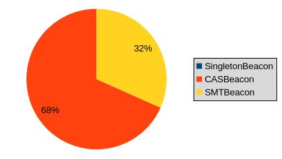
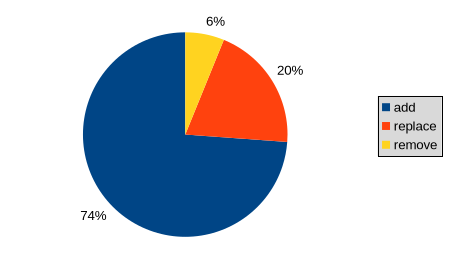
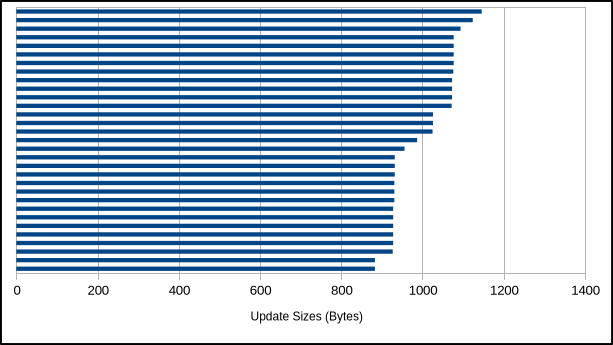
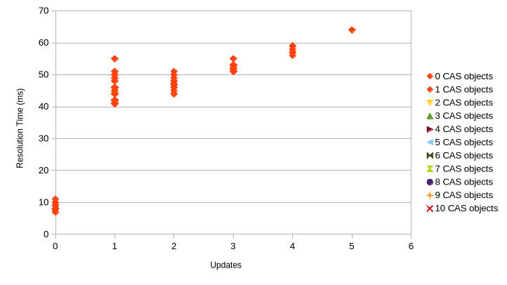

# `did:btcr2` - Data Set 1

## Basic dataset information

**Number of DIDs:** 25

**Number of update rounds:** 10

**Total beacons:** {SingletonBeacon=75, CASBeacon=5, SMTBeacon=5}

**Total beacon services:** {SingletonBeacon=75, CASBeacon=25, SMTBeacon=25}

**Total aggregation cohort types and sizes:**

| Aggregation Cohort                  | Type  | Size |
|:------------------------------------|:-----:|:-----|
| `cohort-mutinynet-cas-1*1337910826` | `cas` | 1    |
| `cohort-mutinynet-cas-3*1281328863` | `cas` | 3    |
| `cohort-mutinynet-cas-5*914489003`  | `cas` | 5    |
| `cohort-mutinynet-cas-7*1215244637` | `cas` | 7    |
| `cohort-mutinynet-cas-9*729704740`  | `cas` | 9    |
| `cohort-mutinynet-smt-4*1313926177` | `smt` | 4    |
| `cohort-mutinynet-smt-5*1558620337` | `smt` | 5    |
| `cohort-mutinynet-smt-5*261042241`  | `smt` | 5    |
| `cohort-mutinynet-smt-5*285767441`  | `smt` | 5    |
| `cohort-mutinynet-smt-6*1459988450` | `smt` | 6    |

## Updates

**Update probabilities per round per DID:** 0.25 (true), 0.75 (false)

**Actual update count:** 60

**Actual update counts per round:** 6,6,4,5,5,5,6,7,8,8


## Updates: Beacons, Operations, Sizes

**Beacon type probabilities per update:** 0.25 (SMTBeacon), 0.75 (CASBeacon)

**Actual updates by beacon types:** {SingletonBeacon=0, CASBeacon=41, SMTBeacon=19}



**Actual update operations:** {add=48, replace=13, remove=4}



**Actual update sizes:** 1076,928,1077,956,1026,1146,931,931,1073,1072,987,932,1077,1077,927,883,932,883,928,1026,928,1073,1094,932,928,1025,931,928,1073,1077,1124,928,1073,1073,1073,928,1026,883,932,932,952,883,1073,928,1073,932,883,932,1073,1073,1073,1073,1026,1073,928,1073,987,1077,1093,1073



## Updates: Sidecar vs. CAS

**Sidecar/CAS probabilities:** 1.0 (Sidecar), 0.0 (CAS)

**Sidecar/CAS genesis documents:** 25:0

**Sidecar/CAS updates:** 60:0

**Sidecar/CAS CAS announcements:** 175:0

**Sidecar SMT proofs:** 75

## Updates: Details

**Actual updates per round per DID:**

```
did:btcr2:x1qh6zcyn4cujckjvw3e2xavq0tmqekakc7ztvan3zlcnn3nn0arp0gqxhxhs -> . . . . O . . . O O (3)
did:btcr2:x1qhyknkc0mgnzvmd0thrervyzznra3g4aj0cwx94qjce24smc9wxrvznf45w -> . . . O . . . . . . (1)
did:btcr2:x1qk97zedp6fu9x5u66dmslcggjdxx45a9qa6talznnvd3nqmz7ekpgwuvwac -> . . . . O . . O O . (3)
did:btcr2:x1qhwuk70cy27mq2c868lfqh0aq5pqs60dls20nkh2rnqhhfdm7yep2u36qlt -> . . . . . O . . . . (1)
did:btcr2:x1qhry9q4eu0xd9ajfqlz6es8ns62rqul8lw8p8g5gnzxwk4x27kj45fxetsq -> . . . . . . . . . . (0)
did:btcr2:x1qhyzucqkesy5xvtn7qtey2fmr5twucughvd0pjq23j56j76t2lnaq2qs0x8 -> O O . . . . O O . . (4)
did:btcr2:x1q4p0n453490yscqge234c2d5ntchrluyrjepu27q2x2ujmpus4am6mn6kgp -> O . . . . O . . O O (4)
did:btcr2:x1q4u7jyej6nfcn36ey668fuqrqr80snq25pdvlgjlje9xty9qreghq29fa3x -> . . . . . . . . O . (1)
did:btcr2:x1qhd2h4sz3wmuylek6afkk58u7gct3xqfsjr0vam4nn0ce0ulnsk8gxeaadg -> . . O . . . . . . O (2)
did:btcr2:x1qk6srpvejjq79azjlnmxk9gy727avvd0ff2jeqql4hrtt8txqwy4s26hee2 -> . . O . . O . . . . (2)
did:btcr2:x1q44lf4zttadxmud0wvkvsjt4mdzuuzggquh390p085mwdq5skkgzwvja2f2 -> . . . O . . . O O . (3)
did:btcr2:x1q5zwvhn9mxytqrqlzdhaupz4h6cg604mr3nu6889kmyvpxm84akgcv8khtr -> . . . O . . O O . O (4)
did:btcr2:x1q4uug0345yvpnle46crhunuvsv5g56vdzdqqpx9t34d5vvrpcxsuxfg54tx -> . O . . O . O . O . (4)
did:btcr2:x1q5szg43j8v0jg6cy24nmkd66l3ukpyrkqz4yfalla3p4dkgykeqxk53jtuj -> O . . . . . . O O O (4)
did:btcr2:x1qh4kprwgtmvqfw5t8raznptmp5ns0e67kgpcq85ttkt08pk7utqpuhunzad -> . . . . . O . . . . (1)
did:btcr2:x1q5095h477lkms95rztnn6x5pvza5s0wh0pg0dtf8mzpf8gytsg9wxsm7g4z -> . . . . . . . . . . (0)
did:btcr2:x1q53hl5sw44ndwmspvh8zytglm73qne9yr7t73waadlnlglxnesd9y0prtp8 -> O . . . . . . . . O (2)
did:btcr2:x1q48sulf78su9xuxrquemgeh492ext47prmjmsjxklknkp5p2asfnwh7wh47 -> . . . . . . O . . . (1)
did:btcr2:x1qkdt3lswmlzl98l4nzpq3ejajk42nnk70f4z4zn4jer3hahhvmmg5d8mxdz -> . O O O O . . O . . (5)
did:btcr2:x1qk64kluzmftxyw2j53emh0sv6r6rqj0ya2k9m6t02vtd49j7rwez666p3z6 -> . O . . O . . . . . (2)
did:btcr2:x1qke552ehmgwmz8nlvtxte48m6hpx9xz56u5szrm8gxc59x49qkp0v3ln37v -> O . . . . . . . . . (1)
did:btcr2:x1q4vncfkdqtd7sfqhpdpk59hy9nxuag82g8r3ugw5cruw3tw9etm0z5e2acj -> . . . . . O . . . O (2)
did:btcr2:x1qk79dxfw6f6p763rup6gzwe25a6zsc6lzm49npc2lwa8qf0el8r4gyy0g7z -> . O . . . . O . . O (3)
did:btcr2:x1qk6qk78p0jc7yvgj4ewmeayc4fmretr8dzw86s05f38hmsjgzaha6e9tzs5 -> O O O O . . . . . . (4)
did:btcr2:x1q454xh7v277ygva485xxsw9897x8z37x8t982lv08v9v7w32a3z0xaxs3cu -> . . . . . . O O O . (3)
```

**Actual updates per round per cohort:**

```
cohort-mutinynet-cas-1*1337910826   -> 0 0 0 0 1 0 0 1 1 0 (3)
cohort-mutinynet-cas-3*1281328863   -> 0 1 1 0 1 0 2 1 1 0 (7)
cohort-mutinynet-cas-5*914489003    -> 0 0 0 0 1 2 0 0 3 0 (6)
cohort-mutinynet-cas-7*1215244637   -> 0 4 2 0 2 1 2 3 1 0 (15)
cohort-mutinynet-cas-9*729704740    -> 0 1 1 0 0 2 2 2 2 0 (10)
cohort-mutinynet-smt-4*1313926177   -> 1 0 0 0 0 0 0 0 0 1 (2)
cohort-mutinynet-smt-5*1558620337   -> 1 0 0 2 0 0 0 0 0 1 (4)
cohort-mutinynet-smt-5*261042241    -> 1 0 0 2 0 0 0 0 0 2 (5)
cohort-mutinynet-smt-5*285767441    -> 1 0 0 0 0 0 0 0 0 1 (2)
cohort-mutinynet-smt-6*1459988450   -> 2 0 0 1 0 0 0 0 0 3 (6)
```

## Resolution Times



versionId, totalResolutionTime, resolutionTime, casAnnouncementCount, smtProofCount, genesisDocumentCidCount, updateCidCount, casAnnouncementCidCount

```
did:btcr2:x1qh6zcyn4cujckjvw3e2xavq0tmqekakc7ztvan3zlcnn3nn0arp0gqxhxhs,1,11,6,0,0,0,0,0
did:btcr2:x1qh6zcyn4cujckjvw3e2xavq0tmqekakc7ztvan3zlcnn3nn0arp0gqxhxhs,2,46,36,3,2,0,0,0
did:btcr2:x1qh6zcyn4cujckjvw3e2xavq0tmqekakc7ztvan3zlcnn3nn0arp0gqxhxhs,3,46,31,7,2,0,0,0
did:btcr2:x1qh6zcyn4cujckjvw3e2xavq0tmqekakc7ztvan3zlcnn3nn0arp0gqxhxhs,4,52,32,7,3,0,0,0
did:btcr2:x1qhyknkc0mgnzvmd0thrervyzznra3g4aj0cwx94qjce24smc9wxrvznf45w,1,9,4,0,0,0,0,0
did:btcr2:x1qhyknkc0mgnzvmd0thrervyzznra3g4aj0cwx94qjce24smc9wxrvznf45w,2,49,39,2,2,0,0,0
did:btcr2:x1qk97zedp6fu9x5u66dmslcggjdxx45a9qa6talznnvd3nqmz7ekpgwuvwac,1,8,3,0,0,0,0,0
did:btcr2:x1qk97zedp6fu9x5u66dmslcggjdxx45a9qa6talznnvd3nqmz7ekpgwuvwac,2,46,36,3,2,0,0,0
did:btcr2:x1qk97zedp6fu9x5u66dmslcggjdxx45a9qa6talznnvd3nqmz7ekpgwuvwac,3,45,30,6,2,0,0,0
did:btcr2:x1qk97zedp6fu9x5u66dmslcggjdxx45a9qa6talznnvd3nqmz7ekpgwuvwac,4,55,35,7,2,0,0,0
did:btcr2:x1qhwuk70cy27mq2c868lfqh0aq5pqs60dls20nkh2rnqhhfdm7yep2u36qlt,1,8,3,0,0,0,0,0
did:btcr2:x1qhwuk70cy27mq2c868lfqh0aq5pqs60dls20nkh2rnqhhfdm7yep2u36qlt,2,42,32,4,2,0,0,0
did:btcr2:x1qhry9q4eu0xd9ajfqlz6es8ns62rqul8lw8p8g5gnzxwk4x27kj45fxetsq,1,9,4,0,0,0,0,0
did:btcr2:x1qhyzucqkesy5xvtn7qtey2fmr5twucughvd0pjq23j56j76t2lnaq2qs0x8,1,8,3,0,0,0,0,0
did:btcr2:x1qhyzucqkesy5xvtn7qtey2fmr5twucughvd0pjq23j56j76t2lnaq2qs0x8,2,55,45,0,1,0,0,0
did:btcr2:x1qhyzucqkesy5xvtn7qtey2fmr5twucughvd0pjq23j56j76t2lnaq2qs0x8,3,51,36,1,1,0,0,0
did:btcr2:x1qhyzucqkesy5xvtn7qtey2fmr5twucughvd0pjq23j56j76t2lnaq2qs0x8,4,52,32,5,2,0,0,0
did:btcr2:x1qhyzucqkesy5xvtn7qtey2fmr5twucughvd0pjq23j56j76t2lnaq2qs0x8,5,57,32,6,2,0,0,0
did:btcr2:x1q4p0n453490yscqge234c2d5ntchrluyrjepu27q2x2ujmpus4am6mn6kgp,1,8,3,0,0,0,0,0
did:btcr2:x1q4p0n453490yscqge234c2d5ntchrluyrjepu27q2x2ujmpus4am6mn6kgp,2,50,40,0,1,0,0,0
did:btcr2:x1q4p0n453490yscqge234c2d5ntchrluyrjepu27q2x2ujmpus4am6mn6kgp,3,48,33,4,2,0,0,0
did:btcr2:x1q4p0n453490yscqge234c2d5ntchrluyrjepu27q2x2ujmpus4am6mn6kgp,4,53,33,7,2,0,0,0
did:btcr2:x1q4p0n453490yscqge234c2d5ntchrluyrjepu27q2x2ujmpus4am6mn6kgp,5,57,32,7,3,0,0,0
did:btcr2:x1q4u7jyej6nfcn36ey668fuqrqr80snq25pdvlgjlje9xty9qreghq29fa3x,1,9,4,0,0,0,0,0
did:btcr2:x1q4u7jyej6nfcn36ey668fuqrqr80snq25pdvlgjlje9xty9qreghq29fa3x,2,41,31,7,2,0,0,0
did:btcr2:x1qhd2h4sz3wmuylek6afkk58u7gct3xqfsjr0vam4nn0ce0ulnsk8gxeaadg,1,8,3,0,0,0,0,0
did:btcr2:x1qhd2h4sz3wmuylek6afkk58u7gct3xqfsjr0vam4nn0ce0ulnsk8gxeaadg,2,45,35,2,1,0,0,0
did:btcr2:x1qhd2h4sz3wmuylek6afkk58u7gct3xqfsjr0vam4nn0ce0ulnsk8gxeaadg,3,46,31,7,3,0,0,0
did:btcr2:x1qk6srpvejjq79azjlnmxk9gy727avvd0ff2jeqql4hrtt8txqwy4s26hee2,1,8,3,0,0,0,0,0
did:btcr2:x1qk6srpvejjq79azjlnmxk9gy727avvd0ff2jeqql4hrtt8txqwy4s26hee2,2,46,36,2,1,0,0,0
did:btcr2:x1qk6srpvejjq79azjlnmxk9gy727avvd0ff2jeqql4hrtt8txqwy4s26hee2,3,47,32,4,2,0,0,0
did:btcr2:x1q44lf4zttadxmud0wvkvsjt4mdzuuzggquh390p085mwdq5skkgzwvja2f2,1,10,5,0,0,0,0,0
did:btcr2:x1q44lf4zttadxmud0wvkvsjt4mdzuuzggquh390p085mwdq5skkgzwvja2f2,2,44,34,2,2,0,0,0
did:btcr2:x1q44lf4zttadxmud0wvkvsjt4mdzuuzggquh390p085mwdq5skkgzwvja2f2,3,47,32,6,2,0,0,0
did:btcr2:x1q44lf4zttadxmud0wvkvsjt4mdzuuzggquh390p085mwdq5skkgzwvja2f2,4,52,32,7,2,0,0,0
did:btcr2:x1q5zwvhn9mxytqrqlzdhaupz4h6cg604mr3nu6889kmyvpxm84akgcv8khtr,1,8,3,0,0,0,0,0
did:btcr2:x1q5zwvhn9mxytqrqlzdhaupz4h6cg604mr3nu6889kmyvpxm84akgcv8khtr,2,41,31,2,2,0,0,0
did:btcr2:x1q5zwvhn9mxytqrqlzdhaupz4h6cg604mr3nu6889kmyvpxm84akgcv8khtr,3,46,31,5,2,0,0,0
did:btcr2:x1q5zwvhn9mxytqrqlzdhaupz4h6cg604mr3nu6889kmyvpxm84akgcv8khtr,4,53,33,6,2,0,0,0
did:btcr2:x1q5zwvhn9mxytqrqlzdhaupz4h6cg604mr3nu6889kmyvpxm84akgcv8khtr,5,56,31,7,3,0,0,0
did:btcr2:x1q4uug0345yvpnle46crhunuvsv5g56vdzdqqpx9t34d5vvrpcxsuxfg54tx,1,8,3,0,0,0,0,0
did:btcr2:x1q4uug0345yvpnle46crhunuvsv5g56vdzdqqpx9t34d5vvrpcxsuxfg54tx,2,48,38,1,1,0,0,0
did:btcr2:x1q4uug0345yvpnle46crhunuvsv5g56vdzdqqpx9t34d5vvrpcxsuxfg54tx,3,47,32,3,2,0,0,0
did:btcr2:x1q4uug0345yvpnle46crhunuvsv5g56vdzdqqpx9t34d5vvrpcxsuxfg54tx,4,51,31,5,2,0,0,0
did:btcr2:x1q4uug0345yvpnle46crhunuvsv5g56vdzdqqpx9t34d5vvrpcxsuxfg54tx,5,58,33,7,2,0,0,0
did:btcr2:x1q5szg43j8v0jg6cy24nmkd66l3ukpyrkqz4yfalla3p4dkgykeqxk53jtuj,1,8,3,0,0,0,0,0
did:btcr2:x1q5szg43j8v0jg6cy24nmkd66l3ukpyrkqz4yfalla3p4dkgykeqxk53jtuj,2,51,41,0,1,0,0,0
did:btcr2:x1q5szg43j8v0jg6cy24nmkd66l3ukpyrkqz4yfalla3p4dkgykeqxk53jtuj,3,48,33,6,2,0,0,0
did:btcr2:x1q5szg43j8v0jg6cy24nmkd66l3ukpyrkqz4yfalla3p4dkgykeqxk53jtuj,4,53,33,7,2,0,0,0
did:btcr2:x1q5szg43j8v0jg6cy24nmkd66l3ukpyrkqz4yfalla3p4dkgykeqxk53jtuj,5,59,34,7,3,0,0,0
did:btcr2:x1qh4kprwgtmvqfw5t8raznptmp5ns0e67kgpcq85ttkt08pk7utqpuhunzad,1,9,4,0,0,0,0,0
did:btcr2:x1qh4kprwgtmvqfw5t8raznptmp5ns0e67kgpcq85ttkt08pk7utqpuhunzad,2,41,31,4,2,0,0,0
did:btcr2:x1q5095h477lkms95rztnn6x5pvza5s0wh0pg0dtf8mzpf8gytsg9wxsm7g4z,1,8,3,0,0,0,0,0
did:btcr2:x1q53hl5sw44ndwmspvh8zytglm73qne9yr7t73waadlnlglxnesd9y0prtp8,1,7,2,0,0,0,0,0
did:btcr2:x1q53hl5sw44ndwmspvh8zytglm73qne9yr7t73waadlnlglxnesd9y0prtp8,2,44,34,0,1,0,0,0
did:btcr2:x1q53hl5sw44ndwmspvh8zytglm73qne9yr7t73waadlnlglxnesd9y0prtp8,3,47,32,7,3,0,0,0
did:btcr2:x1q48sulf78su9xuxrquemgeh492ext47prmjmsjxklknkp5p2asfnwh7wh47,1,8,3,0,0,0,0,0
did:btcr2:x1q48sulf78su9xuxrquemgeh492ext47prmjmsjxklknkp5p2asfnwh7wh47,2,42,32,5,2,0,0,0
did:btcr2:x1qkdt3lswmlzl98l4nzpq3ejajk42nnk70f4z4zn4jer3hahhvmmg5d8mxdz,1,8,3,0,0,0,0,0
did:btcr2:x1qkdt3lswmlzl98l4nzpq3ejajk42nnk70f4z4zn4jer3hahhvmmg5d8mxdz,2,42,32,1,1,0,0,0
did:btcr2:x1qkdt3lswmlzl98l4nzpq3ejajk42nnk70f4z4zn4jer3hahhvmmg5d8mxdz,3,49,34,2,1,0,0,0
did:btcr2:x1qkdt3lswmlzl98l4nzpq3ejajk42nnk70f4z4zn4jer3hahhvmmg5d8mxdz,4,53,33,2,2,0,0,0
did:btcr2:x1qkdt3lswmlzl98l4nzpq3ejajk42nnk70f4z4zn4jer3hahhvmmg5d8mxdz,5,57,32,3,2,0,0,0
did:btcr2:x1qkdt3lswmlzl98l4nzpq3ejajk42nnk70f4z4zn4jer3hahhvmmg5d8mxdz,6,64,34,6,2,0,0,0
did:btcr2:x1qk64kluzmftxyw2j53emh0sv6r6rqj0ya2k9m6t02vtd49j7rwez666p3z6,1,8,3,0,0,0,0,0
did:btcr2:x1qk64kluzmftxyw2j53emh0sv6r6rqj0ya2k9m6t02vtd49j7rwez666p3z6,2,42,32,1,1,0,0,0
did:btcr2:x1qk64kluzmftxyw2j53emh0sv6r6rqj0ya2k9m6t02vtd49j7rwez666p3z6,3,47,32,3,2,0,0,0
did:btcr2:x1qke552ehmgwmz8nlvtxte48m6hpx9xz56u5szrm8gxc59x49qkp0v3ln37v,1,8,3,0,0,0,0,0
did:btcr2:x1qke552ehmgwmz8nlvtxte48m6hpx9xz56u5szrm8gxc59x49qkp0v3ln37v,2,46,36,0,1,0,0,0
did:btcr2:x1q4vncfkdqtd7sfqhpdpk59hy9nxuag82g8r3ugw5cruw3tw9etm0z5e2acj,1,8,3,0,0,0,0,0
did:btcr2:x1q4vncfkdqtd7sfqhpdpk59hy9nxuag82g8r3ugw5cruw3tw9etm0z5e2acj,2,42,32,4,2,0,0,0
did:btcr2:x1q4vncfkdqtd7sfqhpdpk59hy9nxuag82g8r3ugw5cruw3tw9etm0z5e2acj,3,47,32,7,3,0,0,0
did:btcr2:x1qk79dxfw6f6p763rup6gzwe25a6zsc6lzm49npc2lwa8qf0el8r4gyy0g7z,1,8,3,0,0,0,0,0
did:btcr2:x1qk79dxfw6f6p763rup6gzwe25a6zsc6lzm49npc2lwa8qf0el8r4gyy0g7z,2,44,34,1,1,0,0,0
did:btcr2:x1qk79dxfw6f6p763rup6gzwe25a6zsc6lzm49npc2lwa8qf0el8r4gyy0g7z,3,44,29,5,2,0,0,0
did:btcr2:x1qk79dxfw6f6p763rup6gzwe25a6zsc6lzm49npc2lwa8qf0el8r4gyy0g7z,4,53,33,7,3,0,0,0
did:btcr2:x1qk6qk78p0jc7yvgj4ewmeayc4fmretr8dzw86s05f38hmsjgzaha6e9tzs5,1,8,3,0,0,0,0,0
did:btcr2:x1qk6qk78p0jc7yvgj4ewmeayc4fmretr8dzw86s05f38hmsjgzaha6e9tzs5,2,46,36,0,1,0,0,0
did:btcr2:x1qk6qk78p0jc7yvgj4ewmeayc4fmretr8dzw86s05f38hmsjgzaha6e9tzs5,3,50,35,1,1,0,0,0
did:btcr2:x1qk6qk78p0jc7yvgj4ewmeayc4fmretr8dzw86s05f38hmsjgzaha6e9tzs5,4,51,31,2,1,0,0,0
did:btcr2:x1qk6qk78p0jc7yvgj4ewmeayc4fmretr8dzw86s05f38hmsjgzaha6e9tzs5,5,59,34,2,2,0,0,0
did:btcr2:x1q454xh7v277ygva485xxsw9897x8z37x8t982lv08v9v7w32a3z0xaxs3cu,1,7,2,0,0,0,0,0
did:btcr2:x1q454xh7v277ygva485xxsw9897x8z37x8t982lv08v9v7w32a3z0xaxs3cu,2,42,32,5,2,0,0,0
did:btcr2:x1q454xh7v277ygva485xxsw9897x8z37x8t982lv08v9v7w32a3z0xaxs3cu,3,44,29,6,2,0,0,0
did:btcr2:x1q454xh7v277ygva485xxsw9897x8z37x8t982lv08v9v7w32a3z0xaxs3cu,4,51,31,7,2,0,0,0
```
