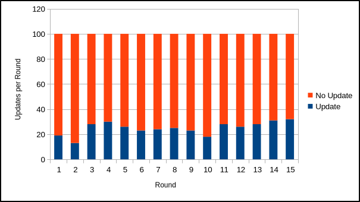
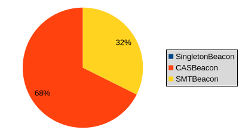
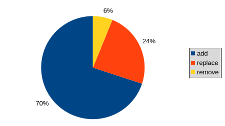
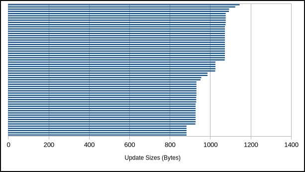

# `did:btcr2` - Data Set 2

## Basic dataset information

**Number of DIDs:** 100

**Number of update rounds:** 15

**Total beacon types:** {SingletonBeacon=300, CASBeacon=100, SMTBeacon=100}

**Total aggregation cohort types and sizes:**

| Aggregation Cohort                   | Type  | Size |
|:-------------------------------------|:-----:|:-----|
| `cohort-mutinynet-cas-7*1454904523`  | `cas` | 7    |
| `cohort-mutinynet-smt-13*733018335`  | `smt` | 13   |
| `cohort-mutinynet-smt-12*691463090`  | `smt` | 12   |
| `cohort-mutinynet-cas-12*504956234`  | `cas` | 12   |
| `cohort-mutinynet-cas-10*1726411591` | `cas` | 10   |
| `cohort-mutinynet-smt-8*58075060`    | `smt` | 8    |
| `cohort-mutinynet-smt-12*1089005101` | `smt` | 12   |
| `cohort-mutinynet-cas-12*698097571`  | `cas` | 12   |
| `cohort-mutinynet-cas-10*269844304`  | `cas` | 10   |
| `cohort-mutinynet-cas-8*1947417726`  | `cas` | 8    |
| `cohort-mutinynet-smt-7*1896204105`  | `smt` | 7    |
| `cohort-mutinynet-cas-9*1932059088`  | `cas` | 9    |
| `cohort-mutinynet-smt-11*1277189404` | `smt` | 11   |
| `cohort-mutinynet-smt-12*508150187`  | `smt` | 12   |
| `cohort-mutinynet-cas-11*1550232856` | `cas` | 11   |
| `cohort-mutinynet-smt-8*2075421493`  | `smt` | 8    |
| `cohort-mutinynet-smt-9*1687143370`  | `smt` | 9    |
| `cohort-mutinynet-cas-13*1685443613` | `cas` | 13   |
| `cohort-mutinynet-cas-8*1037862541`  | `cas` | 8    |
| `cohort-mutinynet-smt-8*1400539705`  | `smt` | 8    |

## Updates

**Update probabilities per round per DID:** 0.25 (true), 0.75 (false)

**Actual update count:** 374

**Actual update counts per round:** 19,13,28,30,26,23,24,25,23,18,28,26,28,31,32



## Updates: Beacons, Operations, Sizes

**Beacon type probabilities per update:** 0.25 (SMTBeacon), 0.75 (CASBeacon)

**Actual updates by beacon types:** {SingletonBeacon=0, CASBeacon=253, SMTBeacon=121}



**Actual update operations:** {add=284, replace=97, remove=25}



**Actual update sizes:** 928,956,1026,928,956,932,882,1077,1068,986,1073,932,932,1072,1077,928,956,1068,1077,1077,932,1026,1073,883,932,952,1026,928,883,963,1026,1073,928,956,883,883,1073,928,956,932,952,1026,932,927,1073,928,956,932,1077,1073,932,1025,928,968,1146,932,1077,952,956,1073,1073,1026,932,883,932,968,928,931,1073,1077,964,1072,1026,927,928,1026,927,883,1026,1072,932,927,1073,956,883,1077,1077,1094,931,1141,927,932,1077,1072,931,1120,1026,1146,1025,932,931,1076,1026,1076,1123,1072,927,1072,987,1094,928,1077,928,1026,1026,932,1026,952,1026,1077,928,883,956,928,1077,1077,932,1077,1025,1026,1077,1073,987,1073,1077,928,1073,928,1026,956,1077,1073,1026,927,928,932,952,1073,1071,1026,928,870,1142,932,952,927,955,883,1073,932,932,928,1073,932,931,1072,1072,932,1026,1146,1026,932,932,1073,928,1026,932,1077,932,1026,883,1073,1094,870,927,928,928,927,928,1073,928,956,928,1026,928,883,1073,882,1073,927,1072,1073,1026,932,870,1077,928,931,1077,964,963,932,1073,952,1094,932,1025,932,883,928,1077,928,1073,932,1026,951,883,1077,1076,931,1026,1072,928,927,882,1073,1076,931,952,928,1073,1077,1068,1026,1077,987,932,931,882,932,1026,932,1076,928,882,1077,932,1076,987,1067,1076,928,1025,883,1077,883,1094,1073,931,952,1026,1142,1077,928,932,883,883,1026,964,1072,932,1025,1077,932,1026,928,1073,1077,1073,1093,1026,1120,931,952,931,1026,952,1026,932,870,1073,987,1026,870,1073,1025,932,932,952,1077,932,1073,1077,951,956,932,1073,1072,1077,987,1072,1120,1073,928,956,952,928,964,968,1026,1077,928,1073,927,1077,882,1073,1072,1073,1073,932,1026,882,869,1142,1073,932,932,1026,952,931,883,882,932,928,1077,986,932,883,964,928,932,883,1077,1025,928,932,1026,927,1072,1072,928,882,927



## Updates: Details

**Actual updates per round per DID:**

```
did:btcr2:x1q4npdvj0kpwmw672cdffplme35uc6k9cp5zfx3jyvjpg3sp88s7ej39lkzc -> . . . . . O . O . . . . . . O (3)
did:btcr2:x1q5jfc2j9qa3xc878meq9w4rql8apmpznhc45lawghy7umf7lr3d72gcdamk -> . . O O . O . . . O . . . O . (5)
did:btcr2:x1qkg3df8ae0wx9aqt7k3k8kstjfldeze6lauc6gx0vq9f3ntz80j75rnee6l -> . O . O . . . . . . O O . O . (5)
did:btcr2:x1qhd4zkendkhptfeqev4ke26vwnupnrd2ukthed3aewdlv5hkc895uvc3jee -> O O . . . . . . . . . O . . . (3)
did:btcr2:x1q4c3s9qacpxus74rmcq5fjlu5s0hd0tjwz9wcwu2dmgavk6fxpllc3765vw -> . . . . . O O O . . . O . O O (6)
did:btcr2:x1qhxyqg0tpu328xr4elejcengcy2s73stcgxa7u520873wgya455rk849s80 -> . . O O . . . . . O . . O O O (6)
did:btcr2:x1qkeemv7xfr7xdc3e8ajww3pp0cpagdtsk33qxx5eupnjwywz25kgcqu3yf6 -> . . . O . O O . . . O . . O O (6)
did:btcr2:x1qk5azpm47l8nezgg3s4r6a8fs4mh65lq6djnsumwldec5xxnhy2lz7qmspl -> . . . O . . . . . . O . . . O (3)
did:btcr2:x1qkql3t7agefq8d3g95xg9mc78p3vxqzmyklt3da7d5vk368flvan6lkzpyq -> . . . . . O O O O . . . O . . (5)
did:btcr2:x1qhq3vqwjalz8zmy6jp535zzk2zflz0f397gdx5l8z29g808crpqyyeps8np -> . . . . . . . . . . . . . . . (0)
did:btcr2:x1qkr5jjvmnsctu6u6pclj2s8vadlcdxz8sk4f30aqnplvy58t92ylyntkpeh -> . . . . O . . . . . . . O O O (4)
did:btcr2:x1q5ara87560ga2p7y0tv7htfew4k2pz9p6w9vzskylu96fkqgy84672r9wev -> . . O . . . . O . O O O . . . (5)
did:btcr2:x1q4vqsuhdal7fpersyq6naamcw2az7dd6f8xfdsk3dchwedj0yacyyr9naj9 -> . O . . . O . . . . . . . . O (3)
did:btcr2:x1qhayuummk49hqs9zzmypvefc064wadfkudy2l4fpyxtq2u73kmtdupnk70r -> O . . O . . O . . . O . O . O (6)
did:btcr2:x1qkdeugekfapkgnkg4qe340mv05y2qf50mn9srk9ustv0ddwznjhnvynufhh -> . . . . O . O . . . . . . . O (3)
did:btcr2:x1q5ymthykal7y7966jzw43vyl3yr70eg4szy9nzyq32dqma2n8yzsqza8wq4 -> . O O . . . . O . . . . . . . (3)
did:btcr2:x1qhx6dzjt4tu6g69rpkscaypuehdf5304j50vtq23xxnj67f483v3sr20xgx -> . O O O . . . . . . O . O O . (6)
did:btcr2:x1qkp8u8d6uaj53kf973lmymgavjgzdggw0grhe8d4t3wshwp7p9kz22l2wec -> . . O . O O . . O . . . . O . (5)
did:btcr2:x1qhk5lmsyc7ddqx6vlxdfhd43cr03zut4rhf5vdc7fexvfyevcwp9w5npqfm -> . . O . . . . . . . . . . O . (2)
did:btcr2:x1q54t9dtfwp8gzjjf5yafl2f4wezv68fzyr4ttsn7ah7qnfjq25kf6sm74dg -> . . . . O . O . . O . . . . . (3)
did:btcr2:x1qhgz53kvwzmsvndzwgwqxvqjagtv9nnz56x5seldj279lfsuf24tjph0ezz -> . . O O . . . . O . . . . . O (4)
did:btcr2:x1qkjvt3xkdqnlk4jnhfamr52nc6urzwg5mk050csx9pwupwk8ah2vj23ezv3 -> . . O . . O . . . O O . O . O (6)
did:btcr2:x1qkyw0emt30q426e9ma6z4m0cenree3gnzqpzmcazgu436cyurgpdyzzrqla -> . . . . . . O O . . . O O O . (5)
did:btcr2:x1qk9zyh8z82auraz3lyjm08mjnfrdppkdgqam7tmjm9l4y83lw64nuzt6dda -> . . . . . . . . . . . O O . O (3)
did:btcr2:x1q5ekwa3pkt73cvuxuf2mnpmutyskduvndcf7v8gudn3kwkvejs29vxu2q7x -> . . O . . O . O . . . . . O O (5)
did:btcr2:x1qh9025526w2ye07ysfqgj2ngqtgyyevxwschswnchkxkv842y804kq9gawj -> . . . . . . O . O . . . . . O (3)
did:btcr2:x1qkt86nr85lvvh9gegv76suw5dm0vtm9fncnng6tyy643m9gqkdhfsnn7nxd -> . . . . O . . O O . O . O . O (6)
did:btcr2:x1q4lnae88t7yyt35sqzrduuway58fmwa52ch0hgd7r9kasaxhzg9dysy9xsc -> . . . . O O . . . . . . . O . (3)
did:btcr2:x1qhhw2z3jw59cc4l48nu2frun5cs78tca908agynhx04j5q8ge0q9w56tv78 -> . . . O . . . . . . . . O O . (3)
did:btcr2:x1q5w7ahj8a59d0097t0agj27rsa07fslc8qdhh9d3vnf432umkuwt59tyhva -> . . O . . . . . . . . . . . . (1)
did:btcr2:x1q46cj2ykzf8lsh0zd7flm5uv3v9mukt30du2y6t7y2nw8qchhn2fsw5wp85 -> . . . . . O . O . . . . . O . (3)
did:btcr2:x1qk3zfd0h3p75455q5n7s6wggel0mfwj3fyj6rms8ay0zd84hnmvl5v82dgp -> . . . . . . . . . O O . . . . (2)
did:btcr2:x1qhmkae9f54jnug3zeq23wce93szrmnzqxsnyfyrl79eay9mlv9705mcwy5e -> . . . . . . . . . . . . O . . (1)
did:btcr2:x1q4pz5vnvhyu2w542lhewvtrmyjwxuhguj70m25hrxp72dgz8lpaa24c6qyz -> . . . . O . O . O . . . O O O (6)
did:btcr2:x1q4xe8t7v43sc9expdqguqjnzl5gk0y2hzkvm06c0zqq2mekz0zgnsj39d66 -> . . . O . . . . . . . . . . O (2)
did:btcr2:x1qk6qttrpwu5x66npelvjc7fk9rzgqyyxmzjmakg35n6tpngj2lg3kgpe9hj -> O O O . . . . . O . . O . . . (5)
did:btcr2:x1q4uy6ket3dqjhnqwdmu66um3edasgxvckgzm2sxzy2hmrf93rkvy2yk3hyf -> O . . . . . . . . . . O . . . (2)
did:btcr2:x1q5q7ccpunyngprla6vznyt34rh7qqhlq53dkcmq8apdjkxchq5kp209f937 -> . . . O O O . O . . . . O O . (6)
did:btcr2:x1qh9x5uxhhrkwxmtfdf0y0y9hce2sdaluxfh4ratfx0j9taqsfplpjpsc398 -> . . O . . . . O . . . . . . . (2)
did:btcr2:x1q4rnahmhmda45vuk55fcasgg3wuv8xg6q07v3unq7w65q8myfdxfxh0346j -> . . . . . . . . . . . . . . O (1)
did:btcr2:x1q4c4w65apg6yzwf0fq4e47f9yz3cm355yajxxm5hjfxmj0mv8pan5430322 -> O . . O . . . . O . . . . . . (3)
did:btcr2:x1q4nt77lc8flntgdm2x9gqhwhp2dauhhyd0d2ggp3p5x8yjfvegvrkhcf0e9 -> O . . O . O . . . . . . . O . (4)
did:btcr2:x1qk3yqdhp3gw7q3cd6jza4yazt7qnj0fxg0an65f66rxjqw09d9hkvc54ekt -> O . . O O O O . . . . O . . O (7)
did:btcr2:x1q5sqjhfr3kd389eygfqjt2zf3sucvd4yh58zgyck9zhm9ej8zs567v7yszg -> . . . . . . O . . O O . . . . (3)
did:btcr2:x1qhhc4nslzx6m7ppp8ly47recz4lejc8u3r0wydzjguh4z9uy90qagc8sudc -> . . . . . . . . O . O . . . . (2)
did:btcr2:x1qh23y7te2sjnfxa06n0c25zfkn52pfr2qtaal8gutkzxlvu4h3xd770uq9u -> . . O . . . . O . . . O . . . (3)
did:btcr2:x1qhdflc4avvvnxleehm7zjlk6vqc72lklxffww7x9h8qequegu9nkq0ctx63 -> . . . . . . O O . . . O O . O (5)
did:btcr2:x1qhlc30akjjzgapt4t5ry36wvt0up7pa8gp7r4vkkpyyxj4cq7nx7k5rpjp3 -> . . O O . . . O O . O . . . O (6)
did:btcr2:x1qhchy6j2xngpmclmtlk8am9egc60w8g83qcxcawffj3smykmzl9kqdl4cpl -> O . . . O . . . . . . . . . . (2)
did:btcr2:x1qh3zk57hqs385u825uclg9h6kjrsvjtt3wzrvn4xrpklc0s0y6vkzx05zz7 -> . . . . . . . . . . . . . . . (0)
did:btcr2:x1qhga7r7lmfp08964kd4nw9ymtzn7sanf6506z99ln4gg5z5d0aftgxxv4xa -> O O O . O . . . . O . O . . . (6)
did:btcr2:x1q56pzt6lxt3qj04csvwruvwwq4tny4c2rjmrf9tzgkfxzuqc9yg8k3rhlc6 -> . . O . . . . . . . O . O . . (3)
did:btcr2:x1qh8hgvprpw6ttnxjpucseavenkkvz7e3a0y3uvzffetltmghskmhzea6e9s -> O . . O . . . . . . . . . O O (4)
did:btcr2:x1qhyfkufh96ctz3fh8pntthmkad993peh3n6j44vc5m3ufc3cul5uz44fkgf -> . . O O . . . . . O O . . . O (5)
did:btcr2:x1qkg50xa2x0whjaeg4dsgd4c35385795ndkl4h3633z3dn4xcarqqgt0gqhq -> . . . . O . O . O . . O . O . (5)
did:btcr2:x1q4ll5dlrseerg5dw2wgcux39jy7lewtejlje2jlr09r5gm62hx8px3p5s45 -> O . O . . . O . . . O O . . O (6)
did:btcr2:x1q4k9dgcqatq2krexcup8wzlvucvghs5v0alph375r90dy2jytnngch55gs2 -> . . . O . . . . . O . . . . . (2)
did:btcr2:x1qhldjsgvnqwj95plnngkmscsyhfwe9lkdzz08pmxz40czm88fcx2z4rgjtg -> . . . . O . O . . . . . O . . (3)
did:btcr2:x1qks5lupt5pmn4cw6h5sderv3gx7r389rtdga6rpz283j7xq57p447a6qec0 -> . . . O O . . . . . . . . . . (2)
did:btcr2:x1qhw8fk9uznru79epw9rh7anjwxw3gxkrmhg7gp448fptkrjzsdzruwz6quz -> . O . . . . . . O . O . . . . (3)
did:btcr2:x1qkepk35th8j8r070l5k8ctgrjpgjveaqs73k0heddvr3q5u8qe555wps34n -> O . O O O . . . O . . O O . . (7)
did:btcr2:x1qkah8suff36tr774sc0gg4fatrw4q8lsp20qzz9a06jh20ylqgzmsl6pjwa -> . . . . . O O . O . O . . . . (4)
did:btcr2:x1qh6j8t6yceawyjvxnz7jgtdruye0n3z8jxmrhn7ax9walld5z9x87t85lle -> O . . O . . O O . O . . . O . (6)
did:btcr2:x1qkul7vtqtv3q7y6z8zs8a5e4k2aean5naqd9ze7p8vetjtyz0zly5kqsmwv -> . . O . . O O . O . . O . . O (6)
did:btcr2:x1q4xee2yyzcx4vkk96qspqyazlf5qjtl7ccfd2ed9rqflufvq9q6rc4s0mfs -> . . O . O . O . . . . . O . . (4)
did:btcr2:x1q4uch0svrdqzgdttt82q8sk86z9q5raz3sclh23racyzpxq8lwxz7j7623h -> . . O . . . O O . . O . . . . (4)
did:btcr2:x1q4svmfu577lc22em55u2wv0vvlcz68ezq63mtcfjgfs55wjr2qlljxv3zta -> . . O . O O . . O O . O . . . (6)
did:btcr2:x1qhxn5xh8dsw332tywnfg3d02pys6cmmf4rerthzm9f5jsw4s5wn7jtx6y2f -> . . O . O O . O . . . . O O O (7)
did:btcr2:x1qhpj9j69a354c6a070fsjkuh95yjyv05y7ed4swkgvtdendkdzktczwggdr -> . . . . . . O O . . O O . O . (5)
did:btcr2:x1qhygfpsf5aj9f5t0pwugskvt7t77jv8cgdq6tz3ul0x4x7wsqxarj992tmu -> O O . . O . . . . . . . . . O (4)
did:btcr2:x1q4g459dgj0w2pt6jwtm84xgmjyy9jsfl48yldzd9c4m7u9gqsecmws743sq -> . . . . . . . O . . . . O O . (3)
did:btcr2:x1qk8y73zg8j3enux98ntscr4savr2gend3mcvdgs60w8r3m88yj8qjjyzqyy -> . . . . . O . . O . O O . . . (4)
did:btcr2:x1qkkz8qzptxugqd70gplvr6elfu5qgs62s4m2gfs2hmmm53ff30p7slgw740 -> O . O . . O . . O . . . . O . (5)
did:btcr2:x1q5telh202v7xsyphscagtzxe4sj0xj5qvtq380x26mg80u332cnw6qycn4v -> . . . . O . . O O . . O . . . (4)
did:btcr2:x1q5nkcjtlx3wevnf7t9lawnyqeeda6u9j4pywl3zdr784tq2ynjfnxjdzcrk -> O . . . . . . . . O . . . . . (2)
did:btcr2:x1qhzj5hj0vs6e9wq6f6cz74yswzevvtfmeupprl0c2504zpjg9s472klp4aq -> . . . . O . . . . O O . . . O (4)
did:btcr2:x1qk7hxsrql5rknuep6zj3quthn8u8junywz92fxhpw7d5jxjn7mv7urfhxfm -> . . . . . . . . . . . . . . . (0)
did:btcr2:x1qkp5694u3uz7nmhezd34fh50cwkgm3ml7xunfdyzmhmd3vsnzeu3vk95xsy -> . . . O . . O . . . . . O . . (3)
did:btcr2:x1q4mdqxgh5gjwuy6agp7nsqt9csj6flujxlr9q7vd8q6ay99sul2jw4n04hf -> . . . . . . . . . . . . . . O (1)
did:btcr2:x1qkmtlhx5u7a45tze6dk8ym2gvqy4sqyzc3z57kgh65xttuaxekzvwruu0my -> . . . O . . . . . . O . O O O (5)
did:btcr2:x1q5hz88zvfw7rm79j5v690fnvuq92mwxegq6qluyclwcmacnt5qpx5qyu2gv -> . . . . . . . . . . O . . . O (2)
did:btcr2:x1q4ehgd8ake4l9p6w9pq7rcenf3mxtqdk9a58sl7k3f3g574vw4ydyded8yw -> . . . . . . O . . . . O O O . (4)
did:btcr2:x1qknc7ppxgylthh2hm950aghul53p3xx3qgcaapwktxjr5he9nweskr54y7k -> . . . O . . . O . . . . . O . (3)
did:btcr2:x1qh5zu20h5hkj43pyy42uw8drenh6dajkfu202chqh4upe9umyfwzw6w0yah -> O . . . . . O . O . . . O . . (4)
did:btcr2:x1q4hvk25t5v6c2tr8keaphqsulxymdnn7cnt8n9fzup0097vxzm046xdg237 -> . . O . O O . . . O O . . . . (5)
did:btcr2:x1qk0lzy4hqn2hlzwzw06ssc9z22gp0ma4jvfcr8ekwsku0v3tjl7y6skh6cp -> . O . . O . . . . . O O . O . (5)
did:btcr2:x1qhf8zp2nntv0uz5kxk20gvev72fu8yf6z9p2wqkcdgcx6w0sg4ey6459f7v -> . . . . . . . . . . . O . . . (1)
did:btcr2:x1q5ud2fwyrw5luewwn6jtzmnyfd2zdqw8jc59nhrmhjecglfcq5l0vl3twde -> . O . O O . . . . . . . O . . (4)
did:btcr2:x1q5n46pwvf0mf277egclcav6a29ehlehj4vt8je57a292k0h3wczy65nrw68 -> . O O . O O . . . . . . . . . (4)
did:btcr2:x1q4r2ed5sud6gze3dhy2ufun3lpu4clc7pta3m7fg93dq0ku7rjxgcvl3a7j -> . . . . . . . . . . . . . . . (0)
did:btcr2:x1q55fhkwqe7efd5zmnsg459ay856g0u6n7mtw5m47ueqmlkg2qk8xyvqxwjc -> . . . . . . . O . O . . . O . (3)
did:btcr2:x1qhua8nlzm50d244rs8tk4tmnwvw36r8wj2yfpuvv3h6l5833ynt0u8s8e5g -> . . . O . . . . . O . O . . O (4)
did:btcr2:x1qh3fkevrepgkptrxhvdj0xk836lfk3gsgryys63vy6ajhjd63p4fve4nxt0 -> . . . O . . . . . O . O . . . (3)
did:btcr2:x1qhdzfl5h43fd4g0t5mykhxgjyc5mq6jmzzjqwgzez68hwx2akjkjxsqvm79 -> . O . O . . . . . . O . O . . (4)
did:btcr2:x1qky384mdc7q28x87c33ntvcvqhkl22em7arpy0z40rnduksxxmsezg6wzrp -> O . . . . . . O . . O . O . . (4)
did:btcr2:x1qkflh5q96twnxx54dhhgl8qgkx4sw3sgut5ag5f2vql6pekq96l4q2jh3kq -> . . . . . . . O O . . . . . . (2)
did:btcr2:x1qkcqhwrzh35sksseljlwt22nlg0634wkjgu5n0f7phd08wnznt28c0at999 -> . . . . . O . . O . . . . O . (3)
did:btcr2:x1qhs5a0r5hrq3uad4k83g6dkh3xdkhw462ajsm03pdg7vjlh02f0w6yq6ec2 -> . . . . O . . . . . . . O . . (2)
did:btcr2:x1qh5m5s5vc08clnnpzgstvjs8hylut65cxl0n0zfpfh3x3a4qxp922w66t62 -> O . . O . . . . . . O . . . . (3)
did:btcr2:x1qk9uaaaha4nxsfrzkzzq68kehg0ud6hyflguk9kkaq9ejvwskag3j8svqr0 -> . . . O . . . O O . . O . O . (5)
```
