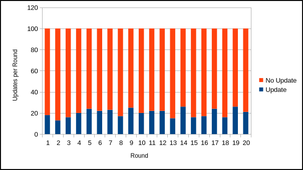
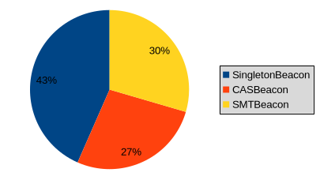
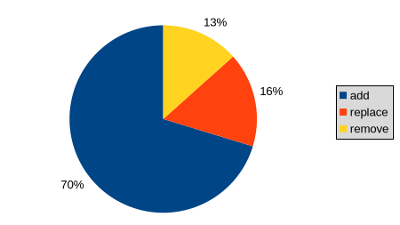
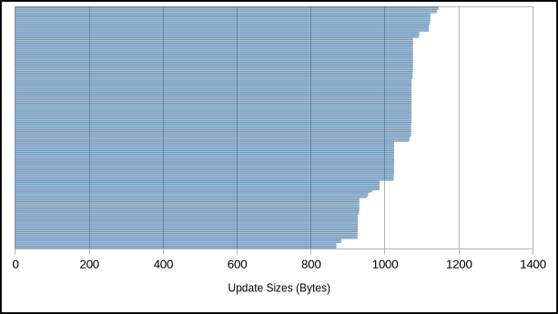

# `did:btcr2` - Data Set 3-3

## Basic dataset information

**Number of DIDs:** 100

**Number of update rounds:** 20

**Total beacons:** {SingletonBeacon=300, CASBeacon=10, SMTBeacon=10}

**Total beacon services:** {SingletonBeacon=300, CASBeacon=100, SMTBeacon=100}

**Total aggregation cohort types and sizes:**

| Aggregation Cohort                   | Type  | Size |
|:-------------------------------------|:-----:|-----:|
| `cohort-mutinynet-cas-8*1567016963`  | `cas` |    8 |
| `cohort-mutinynet-cas-8*2092839258`  | `cas` |    8 |
| `cohort-mutinynet-cas-8*814135560`   | `cas` |    8 |
| `cohort-mutinynet-cas-10*1373633603` | `cas` |   10 |
| `cohort-mutinynet-cas-10*1632062087` | `cas` |   10 |
| `cohort-mutinynet-cas-10*529851527`  | `cas` |   10 |
| `cohort-mutinynet-cas-10*541864111`  | `cas` |   10 |
| `cohort-mutinynet-cas-12*1318389017` | `cas` |   12 |
| `cohort-mutinynet-cas-12*1874395322` | `cas` |   12 |
| `cohort-mutinynet-cas-12*261245263`  | `cas` |   12 |
| `cohort-mutinynet-smt-8*2142964582`  | `smt` |    8 |
| `cohort-mutinynet-smt-8*67259778`    | `smt` |    8 |
| `cohort-mutinynet-smt-9*1001084286`  | `smt` |    9 |
| `cohort-mutinynet-smt-9*533589495`   | `smt` |    9 |
| `cohort-mutinynet-smt-9*977823170`   | `smt` |    9 |
| `cohort-mutinynet-smt-11*1604094573` | `smt` |   11 |
| `cohort-mutinynet-smt-11*41957669`   | `smt` |   11 |
| `cohort-mutinynet-smt-11*449857350`  | `smt` |   11 |
| `cohort-mutinynet-smt-12*1702798122` | `smt` |   12 |
| `cohort-mutinynet-smt-12*666630589`  | `smt` |   12 |

## Updates

**Update probabilities per round per DID:** 0.2 (true), 0.8 (false)

**Actual update count:** 403

**Actual update counts per round:** 18,13,16,20,24,22,23,17,25,20,22,22,15,26,16,17,24,16,26,21



## Updates: Beacons, Operations, Sizes

**Beacon type probabilities per update:** 0.5 (SingletonBeacon) 0.25 (SMTBeacon), 0.25 (CASBeacon)

**Actual updates by beacon types:** {SingletonBeacon=175, CASBeacon=109, SMTBeacon=119}



**Actual update operations:** {add=336, replace=78, remove=64}



**Actual update sizes:** 1026,1077,932,1073,1073,928,964,1026,1073,1077,1093,1026,1141,1072,932,1077,1025,1120,1124,1073,1077,1068,1077,1073,927,987,1073,1026,1142,932,1073,932,1077,1073,1076,1026,1142,1094,928,870,870,1073,1073,927,1072,1072,1026,1073,986,1073,927,987,1025,1026,931,1072,1073,1077,1025,1077,1077,1077,1067,1073,1073,1077,1077,987,987,1094,932,1072,1119,1026,1025,1073,927,1076,1073,1073,928,1073,1026,1146,1077,927,956,987,1073,1073,1073,1120,1026,932,1142,882,1077,1026,1026,1146,927,1068,1077,931,932,883,968,1077,1077,1076,1072,1072,1124,1077,1076,987,1120,986,1026,1077,1073,1072,1026,1073,1071,1026,1073,1026,932,1077,1072,928,932,1072,928,927,1026,1072,1025,1124,1073,1120,1026,1072,1124,1120,1073,1077,1124,932,1093,1073,1073,1073,1123,1120,927,1026,928,883,1073,1026,1076,1094,1073,1026,1076,1073,1073,1026,870,1073,1124,1074,1077,1073,1073,1094,1073,1026,1072,1077,1094,1073,1123,1067,1124,1077,1073,1077,1124,1073,1072,1077,1072,927,1026,1026,869,1026,1146,928,927,931,932,1076,1073,932,1073,1026,870,1073,986,1026,1073,928,1072,1026,1025,1073,928,1123,1073,1124,956,1026,1073,1073,1072,1073,1072,931,1025,928,1026,870,1073,1124,1025,1146,1072,928,1077,1094,870,1026,1141,987,1077,928,1077,1077,1124,955,1077,1073,1025,1073,1026,1026,870,1077,1073,932,1026,928,1026,1073,1120,883,1077,1026,1026,928,955,1077,1026,928,956,1076,928,968,1077,1094,928,870,1026,1146,1077,932,987,1026,1073,1073,928,1026,932,1077,928,1026,1077,1124,1076,1067,1026,1123,1120,987,1077,1077,928,1073,1077,1068,928,1026,1120,1026,928,1025,956,1077,1025,1120,1026,1142,1124,927,1077,1067,1077,927,1025,1073,1077,1073,928,883,1077,987,1026,1073,1076,928,1026,1026,1026,932,883,1124,1073,987,932,1073,951,1077,1073,1073,987,928,1072,1077,1073,1076,1077,931,932,1026,1073,1073,932,1077,928,928,1077,1093,1077,956,932,883,1077,1072,932,1073,1077,1120,1025,1077,1068,932,1073,1073,952,1073,928,987,927,1073,963,1077,1076,1073,1123



## Updates: Sidecar vs. CAS

**Sidecar/CAS probabilities:** 0.5 (Sidecar), 0.5 (CAS)

**Sidecar/CAS genesis documents:** 55:45

**Sidecar/CAS updates:** 187:216

**Sidecar/CAS CAS announcements:** 270:182

**Sidecar SMT proofs:** 600

## Updates: Details

**Actual updates per round per DID:**

```
did:btcr2:x1q5cju4vp6m02geca50l3rqyfnl0w9m0c64sqq8apu46kfdpxeh2mu95kdg7 -> . . . . O . . . . . . . . . . . . . . . (1)
did:btcr2:x1q5us7rmz9ccmpy3tnsa5lqpss9ee2c0z489e9wfe7xcmywqmj2pq5dpp3v3 -> . . . . . . . . . . O O . . . O O O O . (6)
did:btcr2:x1qhnm4szs3qkstcuc5cjmxkgqmk5dm9a2690czfqxgjh850h93th2gkq6g3j -> . . . . . O . . . O O . . . . . O O . . (5)
did:btcr2:x1qhzrlxx5f62znadq3wnzdqt0q5mht07sg0lg7jushdw0ws22ekcyvr25mcf -> O . . . . . O . . . . O . . . O . . O . (5)
did:btcr2:x1q5ujj3g6hush2xvjcv7zs4w9d86nlw20ryvp49m04sl38al8llrz5qdw4yg -> . . . . . . . . . . O . O O O . . . O . (5)
did:btcr2:x1qhfh3yrsa0fqfr7jdznmu6s2w4n9p2uvsq8nz44933u7xup5mrd077cg22x -> O . . . . . . . O . . . . . . O . . O O (5)
did:btcr2:x1q4d9e32qm5flhjhrrlcnuhyyds2nt9xa709k2syydpc2zf4yzzez7axcrj4 -> . . . . O . . . O . . . . . . . . . . . (2)
did:btcr2:x1q40wupt7uznvts47pwc9thj47a90yfx64xv3f9gxevh2gdvkytj3vj7eacf -> . . . . . . . . . . . . . . . . O . . O (2)
did:btcr2:x1qkrkywext475trhml57jrrl57ymxlysx3pevued5yl7zuf7q35y9ct7w98c -> . O . . O . . . . . . . . . . . . . . . (2)
did:btcr2:x1qhl0lwjchx7p2f5uyamh49mh6x4dy5dp83pyt6nxevs9m4grsneq6m04apy -> . . . . . . . . . . . . O . . O O . . O (4)
did:btcr2:x1q537c2p5nusn84pyxdccczzlzpkh3kh8efk8lsyzz3kc65xkxysqk4k5ycp -> . . . O O O . . . . . . O . . . . . . . (4)
did:btcr2:x1qk4ul4dey8gfjeve5564xjm6eyj3at3ngve90cktkaam0zhfy87xg52zzdx -> . . . . . . . O . . . . O . O . O . . . (4)
did:btcr2:x1qkrrr8tkcnqrsuyxf09x6p2a4cu0wdkdzad598996mdyufccwkkajf8tq6m -> . . . . O . . . O . . O . . . . . . . . (3)
did:btcr2:x1qh93cdpx6w9z765sa3s0dw0zjv74w26sp3sr4r37qrcz2exn4phvuau0jps -> . . O . . . . . . O . . . . . . . . . . (2)
did:btcr2:x1q4n4ypvm09c6yqnzynne2vanajahl9fx9tv396dagnrnzywldqqv2px8pkn -> . . . O . . . . O . O O . O . . . . . . (5)
did:btcr2:x1qhjzln2e4p5cuf09xx5cgaaph0nn8vyhpmn9sug0tfl8chnemma250744c5 -> . . . . . . . . . O . O . O O . . . . . (4)
did:btcr2:x1q4sjgf8me08er0jg6wuqweu6sp9kp96s3l2d0amwceckctkjznlu6fjsnl6 -> . . . . . . O . O . . . . O . . O . . . (4)
did:btcr2:x1q59r8dx0fcyc8n45vvlsr7hqqnwwu0tgcpthdcq4p9z62fwwlddxq07cum9 -> . . O . O . . . . . . . . . . . . . . O (3)
did:btcr2:x1qks53tnpkwhechfdcytxz7snfvrsxyglumuk7yqvl3z7xrh8z6jc5pe8rc5 -> . . . . O . O . . . . O O . . . . O O O (7)
did:btcr2:x1q5ry663xn38fle8vuvd5fq5z4ljyk7ch6f6e9envwypfe92wnlh3v7as500 -> O . . . . O . . O . O O . O . . . . . . (6)
did:btcr2:x1q4eprtftf2faegexx5dyldvzj8ja5zyvlqyf3j0uqg2aqhcq40ztz4m8404 -> . . . . . . . . . . O . . . . . . . . . (1)
did:btcr2:x1qhqxpajekyr5gqad2q4mpv9p2nxkw59cfxwrzw5jk3gg8lnzta6fx4f9w6x -> . . O . . . O . . . . . . . . O . . . . (3)
did:btcr2:x1q5863er3g5grsh4f6yjd3le20mzvcaepmdjqzx240sch2ggwk2mdgtm24l2 -> . . . . . . O . . . O . . . . . O . . O (4)
did:btcr2:x1qkq2pk5p3g7n37u83fckj4ntt5u25y2vysd2ndtqxfqrh3ur3nnt70ws65y -> . . . . . . . . . . . . . . . O . . . . (1)
did:btcr2:x1q4z20ajmx7nls5tvgu0rkkpqsepcheq06chlzazx0urtv76zxq4tcgznx3p -> . O . . . O O . . . O . . . O . . . . O (6)
did:btcr2:x1qh8nlk0nr58lsg4n8ju77a70pl0t4dsfy4udgm70cxgswt2qyhr5z7rpamj -> . . . . . . O . . O . O . . . . . O O O (6)
did:btcr2:x1qkdjepk592htyl3fdx42z2hwxpt7zq40pvlpch74vmwkp9p9rynezkzvxlp -> . . O . . . . . O . . . . . . . O . O . (4)
did:btcr2:x1q40ng79kvek3tnfw3n72686j5e78e796750spu2tywqqazm2540qjs2gjms -> . . . . . . . . . . . . . . . . O O . . (2)
did:btcr2:x1q4wr9tm5mc5t2zqkgc8a4dxe09xrc3jnj0r2fahhg6wsaehnz49rk484q60 -> . . . . O . O . O . . O . O . O . . . . (6)
did:btcr2:x1qhjncjvgkgny8q9r8wv8xvvez4xk5x677v268ua9rpmfvljvjwqw6f68uy7 -> . . . . . O O . . O . . . O O . . . . . (5)
did:btcr2:x1qh74v4fxhmnnc32ua74vch7hukmjhs4zr6t0gxvdvsd0m77a8x5wk390mm3 -> . . . . O O . O . . . . . . O . . . . O (5)
did:btcr2:x1qkuxdrgelu5rxmqsek0yngfhqsau5kryzk6ysk2ykllc3pwf9gsvcn6n5tq -> O . . . O . . . . O . . . . O . . . O O (6)
did:btcr2:x1qhfq73kj9tw9u8ylsqttfmmk37d7uck757f2sdh945xuz0fyt6kx77g7t8k -> . O . . O . O . . O . . . . . . . . . . (4)
did:btcr2:x1q5s7agwrzgmku4g2h8sxv80reprtq0d75jr4yp00v7npala5nsn62jkpzk6 -> . . . . . . . O O . O . O . . . . . . . (4)
did:btcr2:x1qh3kp2ppajcmnp3s9erwac9ud6uqzd52f2dvwft8phmqdl63dpfsq8mfk6e -> . . . O . . O . . O . . . . . . O . . . (4)
did:btcr2:x1qhhzjmt63skrppfksru8wegg85avv54c86d5409r90dyn7zd3kxgywegkyc -> . O O O . . . . O . . O . . . O . . . . (6)
did:btcr2:x1q43jt2dw9ug4vap2e2sa67np4d5ulgnhtnfs360hyzkymtjw22yk7q9ku2k -> . O O . . . . . . . . . . O . . . . . . (3)
did:btcr2:x1q5n6xxgj5esnzz52zrd0wj6ly9xwjvzp0m058jauezjna67cy0pakug8pmh -> . . . . . . O . O . . . . . . O . . . . (3)
did:btcr2:x1qkg8vz8u4ctlkghnntugu6ss6tlyv5mxh35ktaa8784s4j66e7sug3d02hk -> . . . . . O . . O . . . . O . . . . . . (3)
did:btcr2:x1qh5t07hzucuktere54ggzxzcslj8kp9qafn708d757vpzawx6xddzmtx2jh -> O . . . . . . O . . . . . . . . . . . . (2)
did:btcr2:x1qklyz94fmn0ayvuas2cdkn57s2735e35axmps7fmck2mkjz5z6xqysekhr0 -> . . O . . . . . . . . . O . . O O . . . (4)
did:btcr2:x1qkc7vd9c04se79xe5r7npw2u30zrfd9tkslaet2ywgtx2f92ucvhvfaaazv -> . . . O . O . . O . . O . . . . . . . . (4)
did:btcr2:x1q5t0re50ks5a4t8xr7s5ez0mf3dlnt235ecdn50c4dz9fujmdq83jrnwujw -> . O . . . . O . O . . . . O . . . . . . (4)
did:btcr2:x1q40stun86ncym8g3pzjj30f2zmqkf86wcd2uy9jf6zf09cs62mjns54r0sq -> . . . O . . . . . . . O . . . . . . . . (2)
did:btcr2:x1q5tpaen3ddtlawequev79r8jkymfmu634s4u455f44467ca8yyc5un3k4m7 -> . . . . . . . O . . . . . . . . . . . . (1)
did:btcr2:x1qhjam6rndpcvcwvhk8txzpk7q625qekjns3xx9uxrqs2sl9t23936n8ry0t -> . . . . . O O O . O O . . . . . . O . . (6)
did:btcr2:x1q4pzvf64nzzufxqxtpu50vvncptptht965vu8xdc6lpddhr75wgqxsuu03p -> O O . O . . . . . . . . . O . O . O O . (7)
did:btcr2:x1q5ntunlad4pwr0kgj59zvdnwc3x3rmmk7cfaregznw3f7yycclvcgevcgvw -> . O . O . . . . . O . . . . . . O . . . (4)
did:btcr2:x1qhwyxa8empgef9wlhdsv7e2kmjus2ua0mpfr42hcujzrccksylrmvhsngxt -> . . . . . . . . . . . . O O . . . . O O (4)
did:btcr2:x1q5677h5jxshhqnqjyd8cexd7jx3vhsyn279jzmgntvhlrfq5fxfcxygu078 -> O . O . . O O . . . . . O O . . . . . . (6)
did:btcr2:x1q4jglj987mrvtfk36ek5vh0skjy9622h9quz5jyn9htktc54tsc0jlt89jn -> . . O . . . . . O . . . . O . . . . O . (4)
did:btcr2:x1q40mqrzene9yznhd7gy0c2qhepjzk24cjgfd6y3c07m0k2pvg5mkwjfr6kj -> . . . . . . . O . . . O . . . . O . . . (3)
did:btcr2:x1q4cjclckzpgych0n92hv7xgd5c86uk465mn3fdp2c8087q7mt7uy52vvtyh -> . . . . O . . . . . . . O . . O O . O . (5)
did:btcr2:x1qka25w6t56ls4nguqwge5cpqepz5e6wxw666de0uax7jmjzw2jsx29uuwnu -> O . . . . . . . . . . . . . . . O . O . (3)
did:btcr2:x1qkt2ryvkffdsatzq2u8n5tcmge5q0ufn8tmc96qtxqdtudj5g8ftq09y0jp -> . . . . O O . O . O . . O O . . . . O . (7)
did:btcr2:x1qhkxdrl20wjzhp5x2hz33j8nv2z22aukxlxzs2u0y5dvdxj3ysplxj8ujxn -> O . . . . . . . . . . . . . . . . . O . (2)
did:btcr2:x1q5mrfpt2fwn8d563uuplwldcjal39suz6j0m3l6d9rlmpsssycujke0qe9u -> . . O . O . . O . . . . . . . . . O O . (5)
did:btcr2:x1qhv6d5cpkmgmqm0v3le32lpa4hx0vgyk9xea5nksc4kv6u78teclu2jlzq8 -> . . . . . . . . . . . O . . . . . . . . (1)
did:btcr2:x1q4hh7l9rc5dcxweqemys8sxf3jlxur8ty8chqzkvu35x758rxhsp65awz63 -> . . . O . . . . . . . . . . . . . . . . (1)
did:btcr2:x1q5vkzs4xnkcywhaetgadm0dgalqq55pyxkv5xsev4tp8pfjeqqfzxufz08u -> O . . . . . O . . . O . . . . . . . . . (3)
did:btcr2:x1q472en933d7jel8frqfmat9nva4kl25mzs34gcjhzvygqehfepkauqj5f3m -> O . O O . . . . . O . . . . O . . O . . (6)
did:btcr2:x1qkantj0jfgad93xy77d77cv0jertq8v5gm7ua97lwvxxxn4d49p65uefpt0 -> . O . . . . . . . . O . . . . . . . . . (2)
did:btcr2:x1qkxql3zfv4jq7htkv2vs0k9tguaylk02h4phwtz4ymkkxk6a86smkxtz9vv -> . . . O . O . . O . . O . . O . . O . O (7)
did:btcr2:x1qkrl4qusfh3fnqmhzjvcql9wjnj8msf2kmxgltvgp7mrrhxz695ajfxtvpq -> . . . O . . . . O . . O . . . . . . . . (3)
did:btcr2:x1q55n4y8utcl5n3py92wnrn5k93vga5h769j7jmpdjr2xqd026hueyxhg2tn -> . . . O . O . . . . . O . . O . O . . . (5)
did:btcr2:x1q54m6atze59jpmzw4w2ztr0kdxvsr8mmm9ayghq4j3m504kcfpfdcxfdj9l -> . . . . . . . O . . O O . . . O . . O O (6)
did:btcr2:x1q4739r2jkq9h7fu45ja96k2wmnx2jlenkrla80wxvqgdj3j39y9vyafcgrq -> . . . . . . . . . O O . . . . . . . . . (2)
did:btcr2:x1qknen65t0ja3wuz6peakhlkauup44pu98ex984untkj49g6tuqs8wlte5af -> . . . . . . . . O . . . . O . . O . O . (4)
did:btcr2:x1qkn54kmuppqc5pq99ng5lyyxhx5428agzwkgfd3h5lx54hsmgkakk3ej793 -> . . . . . . . O . . . . . . . . . . O . (2)
did:btcr2:x1qk8tz23ml3qw0edhna0pa4me3kfrmea27cdgjka7p5dxsg9nh7klx6wuxdr -> . . . . . O . . . . . . . . . . . . . . (1)
did:btcr2:x1qhyge3tzasmalwdlmguv0g5vgcyr3u7xhvq43q0qaqp3djx9r8upcd2ff5j -> O . . O . . . O . O . . . O O O . . . . (7)
did:btcr2:x1qk4qf0ffrvqhehdg6vwne3ar0auvsfkq7l373c4u9qmf9pzfgn9yg8p4urr -> . . O . O . . O . . . . . . . . . . . . (3)
did:btcr2:x1q4n603mc7a0x7cdy5rq2tmulf0enp5ytmg366vfh9q7xc5xf930ev6mgunx -> . . . O O . . . . . . O . . O . . O . . (5)
did:btcr2:x1q5ngcrzgexq9q3ed6hax90t9qz3u3tr6e25226fu340c3k30qm8sggyagkn -> . O . . . . . O . . . . . . . . . . O . (3)
did:btcr2:x1qh4zvtulna68qyalutve249jpcw6dluwamuqzquvdnv00yn3vcdv5v2jd98 -> O . . . O O O . . . . . . . . . O . O . (6)
did:btcr2:x1q4yu37mu5g6ww7ly4843qdzkawcjdaht4mm7fwtnrdm4ykqp39k7u8dqcxs -> . . . . . . . . . . . . . . . . . . . O (1)
did:btcr2:x1qknlsctj6wd754tgtpxl3gkas62rmjdncat55puncg0zqu7rkw435c6nc50 -> . . O . . O . . . . . O . . . . O . . . (4)
did:btcr2:x1q45ed3mjgadckxae9lcujyncv3x3rvfxdx26ufqlvfnl83tp4rzqz3vlksh -> . . . . . . O . . . O . . O . . O . . O (5)
did:btcr2:x1qkal48yjx2f32ep678upwfch9qsu8rn3ry7g5e6pn5f33cymlz6u588sv2c -> . . . . O O . O . . . . . . . . . . O . (4)
did:btcr2:x1q5yu873mzduw7nlv8tc4f07ut52acz9pwksz6jxsyaha78wpz90kx0c3ear -> . . O . . . . . . . O . . . . . . . . . (2)
did:btcr2:x1qhlruy46g0l3pyeemhk3z52qn2amgxdlwjaax6an7te9x007ju7ksuqj6me -> O . . . . . O . . . . . . O . . . . . . (3)
did:btcr2:x1q47qydqqtnr0wlkdkaw59ckenq6adqze4e0vppcrw8cxx35mh77cxjza4kr -> O . . . O . . . . . . . . O . . O O O . (6)
did:btcr2:x1qhx7z3zp4j422cv66g0r8xd9qv85k5gw58twpgtdq2zumrwcs9n0s3d9dt6 -> . . . . O . . . . . . . . O . . . . . O (3)
did:btcr2:x1qk89lfq5vju7xx0sf498k3jh3p7dytrdax5w8hrlvq5tfjfmfrktc7fxa30 -> . . . . . . O . O O . . O . . . . . . . (4)
did:btcr2:x1q4ug6jra97w2chaq0x8f9l679xs9pc4ucknntmdqhz787vwf2wxm7z0yh0a -> . . . . . . . . . . . . . . . . . . O O (2)
did:btcr2:x1qkhce4sudk8qx4g0a05zapx83dgpckwlr722ten466mdzmdc9u32s0yy4g7 -> . . . O . . . . O O . . . . . . . O . O (5)
did:btcr2:x1q4axwnk5zqk9ckwmff8v42ycu9alxgzutsu4qanx9ectk9xm8zp5cgeqy5h -> . . O O . . . . . . . . . . . . . . . . (2)
did:btcr2:x1q5efjmtut6lapyttdtquae6p9eawruzhp56vxkzqpv2umr8udsga6ltjjvk -> . . O . . . O O . O O . . . . . . O . O (7)
did:btcr2:x1qh45gz0w5jup4nvcsv3jy3d23gyr8h9f0q4wnkh7zdwhhdn5lsjuct3wfh3 -> . . . . . O . . . . . . O O . O . O . . (5)
did:btcr2:x1q5w7fze2du3ulr66p57pylf0m86qafmnkys2df377de8xqwk5cagk4555ft -> O . . . O . O . . . O . . . O . . . . . (5)
did:btcr2:x1qh2sehp07qvm540ekgq6a7rc9a5rgnnwg96n5mlnsax0c4966a0assmyrng -> . . . . O O . . O O . . . . O . . . O . (6)
did:btcr2:x1qkqe9rgngxwhmd8uvw57znvcp85u2pt0spg8uzr3z6sxee2qyvl0z5gnvvq -> . O . . . . . . O . . . . . . . O . . O (4)
did:btcr2:x1q440w4trdr3968750cawvmk6my2atu7vdmwjdt773nzyjhqes6j2ycvna0j -> . O . . O O . . . . . . . . . . . . . O (4)
did:btcr2:x1qhugkkt4zv7aw0u7kjaqs58u995u22fsvpxkg4s9fwlz3kvmvj27kyreqa3 -> . . . O . . . O O . . O . O . . O O . . (7)
did:btcr2:x1q4cy8vmdhvv4fqeuzzpcupg9jd09py6e78gug3xq2uktccg9rjv9u2a4qtg -> . . . . . . . . . . O . . . . . . . . . (1)
did:btcr2:x1q4g3v48gzhveupyf3ssut0yr0n4rjejc5x8xeh4rm2ndy8m8rq4aw2zuvt0 -> O . . O . . O . . O . . O O . . . . . . (6)
did:btcr2:x1q5ghckcjavrrmfmypdcsmy3npcc7z0ndcn3mvf2zfxu6ennhmyugq85crtn -> . . . . . O . . . . O . . . . O . . . . (3)
did:btcr2:x1qhr9xlhvy6tq4q0k2py7fxsedev56lkv8lvk40rehcp0gxzxfndlkl3cegj -> O . . O O O . . O . . . . O O O O . . . (9)
did:btcr2:x1qhyrqv7swpa7vqyym80njh2dn46200lx55ydmgc827tmf6adnq7sgzs34vq -> . O . . . . . . . . O O O . . . . . . . (4)
did:btcr2:x1q43ugcghuy5xqz3vzfztu9eqgqcaxkgudrzhqm29ccux84c5gl4j5txtvwu -> . . . . . . . . O O O . . O O . . . O . (6)
```

**Actual updates per round per cohort:**

```
cohort-mutinynet-cas-8*1567016963   -> 0 0 0 0 0 0 1 0 0 1 0 0 0 0 3 0 0 0 0 0 (5)
cohort-mutinynet-cas-8*2092839258   -> 0 0 0 0 0 0 2 0 0 2 0 0 0 2 1 0 1 0 0 0 (8)
cohort-mutinynet-cas-8*814135560    -> 0 0 0 0 0 0 1 0 0 1 0 0 0 2 0 0 2 0 0 0 (6)
cohort-mutinynet-cas-10*1373633603  -> 0 0 0 0 0 0 4 0 0 4 0 0 0 4 1 0 4 0 0 0 (17)
cohort-mutinynet-cas-10*1632062087  -> 0 0 0 0 0 0 0 0 0 0 0 0 0 1 0 0 2 0 0 0 (3)
cohort-mutinynet-cas-10*529851527   -> 0 0 0 0 0 0 3 0 0 1 0 0 0 1 4 0 1 0 0 0 (10)
cohort-mutinynet-cas-10*541864111   -> 0 0 0 0 0 0 2 0 0 2 0 0 0 3 1 0 4 0 0 0 (12)
cohort-mutinynet-cas-12*1318389017  -> 0 0 0 0 0 0 3 0 0 4 0 0 0 5 3 0 5 0 0 0 (20)
cohort-mutinynet-cas-12*1874395322  -> 0 0 0 0 0 0 5 0 0 3 0 0 0 3 1 0 3 0 0 0 (15)
cohort-mutinynet-cas-12*261245263   -> 0 0 0 0 0 0 2 0 0 2 0 0 0 5 2 0 2 0 0 0 (13)
cohort-mutinynet-smt-8*2142964582   -> 0 0 0 2 0 0 0 1 3 0 2 0 0 0 0 0 0 0 0 0 (8)
cohort-mutinynet-smt-8*67259778     -> 0 1 0 1 0 0 0 0 6 0 0 3 0 0 0 0 0 0 0 0 (11)
cohort-mutinynet-smt-9*1001084286   -> 0 2 0 3 0 0 0 1 4 0 2 4 0 0 0 0 0 0 0 0 (16)
cohort-mutinynet-smt-9*533589495    -> 0 1 0 3 0 0 0 2 2 0 2 3 0 0 0 0 0 0 0 0 (13)
cohort-mutinynet-smt-9*977823170    -> 0 1 0 1 0 0 0 3 1 0 3 1 0 0 0 0 0 0 0 0 (10)
cohort-mutinynet-smt-11*1604094573  -> 0 0 0 3 0 0 0 2 1 0 3 3 0 0 0 0 0 0 0 0 (12)
cohort-mutinynet-smt-11*41957669    -> 0 4 0 3 0 0 0 2 2 0 2 0 0 0 0 0 0 0 0 0 (13)
cohort-mutinynet-smt-11*449857350   -> 0 3 0 2 0 0 0 0 2 0 2 2 0 0 0 0 0 0 0 0 (11)
cohort-mutinynet-smt-12*1702798122  -> 0 1 0 0 0 0 0 4 1 0 3 3 0 0 0 0 0 0 0 0 (12)
cohort-mutinynet-smt-12*666630589   -> 0 0 0 2 0 0 0 2 3 0 3 3 0 0 0 0 0 0 0 0 (13)
```

**Resolution times:**

versionId, totalResolutionTime, resolutionTime, casAnnouncementCount, smtProofCount, genesisDocumentCidCount, updateCidCount, casAnnouncementCidCount

```
did:btcr2:x1q5cju4vp6m02geca50l3rqyfnl0w9m0c64sqq8apu46kfdpxeh2mu95kdg7,1,9,4,0,0,0,0,0
did:btcr2:x1q5cju4vp6m02geca50l3rqyfnl0w9m0c64sqq8apu46kfdpxeh2mu95kdg7,2,63,53,0,2,0,0,0
did:btcr2:x1q5us7rmz9ccmpy3tnsa5lqpss9ee2c0z489e9wfe7xcmywqmj2pq5dpp3v3,1,8,3,0,0,0,0,0
did:btcr2:x1q5us7rmz9ccmpy3tnsa5lqpss9ee2c0z489e9wfe7xcmywqmj2pq5dpp3v3,2,85,55,2,5,0,1,0
did:btcr2:x1q5us7rmz9ccmpy3tnsa5lqpss9ee2c0z489e9wfe7xcmywqmj2pq5dpp3v3,3,112,57,2,6,0,2,0
did:btcr2:x1q5us7rmz9ccmpy3tnsa5lqpss9ee2c0z489e9wfe7xcmywqmj2pq5dpp3v3,4,160,60,4,6,0,3,1
did:btcr2:x1q5us7rmz9ccmpy3tnsa5lqpss9ee2c0z489e9wfe7xcmywqmj2pq5dpp3v3,5,166,61,5,6,0,3,1
did:btcr2:x1q5us7rmz9ccmpy3tnsa5lqpss9ee2c0z489e9wfe7xcmywqmj2pq5dpp3v3,6,191,61,5,6,0,4,1
did:btcr2:x1q5us7rmz9ccmpy3tnsa5lqpss9ee2c0z489e9wfe7xcmywqmj2pq5dpp3v3,7,217,62,5,6,0,5,1
did:btcr2:x1qhnm4szs3qkstcuc5cjmxkgqmk5dm9a2690czfqxgjh850h93th2gkq6g3j,1,28,3,0,0,1,0,0
did:btcr2:x1qhnm4szs3qkstcuc5cjmxkgqmk5dm9a2690czfqxgjh850h93th2gkq6g3j,2,87,57,0,2,1,0,0
did:btcr2:x1qhnm4szs3qkstcuc5cjmxkgqmk5dm9a2690czfqxgjh850h93th2gkq6g3j,3,112,57,2,4,1,0,1
did:btcr2:x1qhnm4szs3qkstcuc5cjmxkgqmk5dm9a2690czfqxgjh850h93th2gkq6g3j,4,119,59,2,5,1,0,1
did:btcr2:x1qhnm4szs3qkstcuc5cjmxkgqmk5dm9a2690czfqxgjh850h93th2gkq6g3j,5,164,59,5,6,1,1,2
did:btcr2:x1qhnm4szs3qkstcuc5cjmxkgqmk5dm9a2690czfqxgjh850h93th2gkq6g3j,6,194,64,5,6,1,2,2
did:btcr2:x1qhzrlxx5f62znadq3wnzdqt0q5mht07sg0lg7jushdw0ws22ekcyvr25mcf,1,9,4,0,0,0,0,0
did:btcr2:x1qhzrlxx5f62znadq3wnzdqt0q5mht07sg0lg7jushdw0ws22ekcyvr25mcf,2,95,65,0,0,0,1,0
did:btcr2:x1qhzrlxx5f62znadq3wnzdqt0q5mht07sg0lg7jushdw0ws22ekcyvr25mcf,3,92,57,1,2,0,1,0
did:btcr2:x1qhzrlxx5f62znadq3wnzdqt0q5mht07sg0lg7jushdw0ws22ekcyvr25mcf,4,120,60,2,6,0,1,1
did:btcr2:x1qhzrlxx5f62znadq3wnzdqt0q5mht07sg0lg7jushdw0ws22ekcyvr25mcf,5,125,60,4,6,0,1,1
did:btcr2:x1qhzrlxx5f62znadq3wnzdqt0q5mht07sg0lg7jushdw0ws22ekcyvr25mcf,6,152,62,5,6,0,2,1
did:btcr2:x1q5ujj3g6hush2xvjcv7zs4w9d86nlw20ryvp49m04sl38al8llrz5qdw4yg,1,28,3,0,0,1,0,0
did:btcr2:x1q5ujj3g6hush2xvjcv7zs4w9d86nlw20ryvp49m04sl38al8llrz5qdw4yg,2,105,55,2,5,1,0,1
did:btcr2:x1q5ujj3g6hush2xvjcv7zs4w9d86nlw20ryvp49m04sl38al8llrz5qdw4yg,3,111,56,2,6,1,0,1
did:btcr2:x1q5ujj3g6hush2xvjcv7zs4w9d86nlw20ryvp49m04sl38al8llrz5qdw4yg,4,161,61,3,6,1,1,2
did:btcr2:x1q5ujj3g6hush2xvjcv7zs4w9d86nlw20ryvp49m04sl38al8llrz5qdw4yg,5,212,87,4,6,1,2,2
did:btcr2:x1q5ujj3g6hush2xvjcv7zs4w9d86nlw20ryvp49m04sl38al8llrz5qdw4yg,6,210,60,5,6,1,2,3
did:btcr2:x1qhfh3yrsa0fqfr7jdznmu6s2w4n9p2uvsq8nz44933u7xup5mrd077cg22x,1,8,3,0,0,0,0,0
did:btcr2:x1qhfh3yrsa0fqfr7jdznmu6s2w4n9p2uvsq8nz44933u7xup5mrd077cg22x,2,91,61,0,0,0,1,0
did:btcr2:x1qhfh3yrsa0fqfr7jdznmu6s2w4n9p2uvsq8nz44933u7xup5mrd077cg22x,3,115,60,1,4,0,2,0
did:btcr2:x1qhfh3yrsa0fqfr7jdznmu6s2w4n9p2uvsq8nz44933u7xup5mrd077cg22x,4,164,64,4,6,0,2,2
did:btcr2:x1qhfh3yrsa0fqfr7jdznmu6s2w4n9p2uvsq8nz44933u7xup5mrd077cg22x,5,189,64,5,6,0,2,3
did:btcr2:x1qhfh3yrsa0fqfr7jdznmu6s2w4n9p2uvsq8nz44933u7xup5mrd077cg22x,6,193,63,5,6,0,2,3
did:btcr2:x1q4d9e32qm5flhjhrrlcnuhyyds2nt9xa709k2syydpc2zf4yzzez7axcrj4,1,29,4,0,0,1,0,0
did:btcr2:x1q4d9e32qm5flhjhrrlcnuhyyds2nt9xa709k2syydpc2zf4yzzez7axcrj4,2,105,55,0,2,1,1,0
did:btcr2:x1q4d9e32qm5flhjhrrlcnuhyyds2nt9xa709k2syydpc2zf4yzzez7axcrj4,3,110,55,1,4,1,1,0
did:btcr2:x1q40wupt7uznvts47pwc9thj47a90yfx64xv3f9gxevh2gdvkytj3vj7eacf,1,28,3,0,0,1,0,0
did:btcr2:x1q40wupt7uznvts47pwc9thj47a90yfx64xv3f9gxevh2gdvkytj3vj7eacf,2,145,55,5,6,1,0,3
did:btcr2:x1q40wupt7uznvts47pwc9thj47a90yfx64xv3f9gxevh2gdvkytj3vj7eacf,3,152,57,5,6,1,0,3
did:btcr2:x1qkrkywext475trhml57jrrl57ymxlysx3pevued5yl7zuf7q35y9ct7w98c,1,28,3,0,0,1,0,0
did:btcr2:x1qkrkywext475trhml57jrrl57ymxlysx3pevued5yl7zuf7q35y9ct7w98c,2,103,53,0,1,1,1,0
did:btcr2:x1qkrkywext475trhml57jrrl57ymxlysx3pevued5yl7zuf7q35y9ct7w98c,3,134,59,0,2,1,2,0
did:btcr2:x1qhl0lwjchx7p2f5uyamh49mh6x4dy5dp83pyt6nxevs9m4grsneq6m04apy,1,28,3,0,0,1,0,0
did:btcr2:x1qhl0lwjchx7p2f5uyamh49mh6x4dy5dp83pyt6nxevs9m4grsneq6m04apy,2,107,57,2,6,1,0,1
did:btcr2:x1qhl0lwjchx7p2f5uyamh49mh6x4dy5dp83pyt6nxevs9m4grsneq6m04apy,3,153,58,4,6,1,1,2
did:btcr2:x1qhl0lwjchx7p2f5uyamh49mh6x4dy5dp83pyt6nxevs9m4grsneq6m04apy,4,178,58,5,6,1,1,3
did:btcr2:x1qhl0lwjchx7p2f5uyamh49mh6x4dy5dp83pyt6nxevs9m4grsneq6m04apy,5,204,59,5,6,1,2,3
did:btcr2:x1q537c2p5nusn84pyxdccczzlzpkh3kh8efk8lsyzz3kc65xkxysqk4k5ycp,1,28,3,0,0,1,0,0
did:btcr2:x1q537c2p5nusn84pyxdccczzlzpkh3kh8efk8lsyzz3kc65xkxysqk4k5ycp,2,86,56,0,2,1,0,0
did:btcr2:x1q537c2p5nusn84pyxdccczzlzpkh3kh8efk8lsyzz3kc65xkxysqk4k5ycp,3,91,56,0,2,1,0,0
did:btcr2:x1q537c2p5nusn84pyxdccczzlzpkh3kh8efk8lsyzz3kc65xkxysqk4k5ycp,4,117,57,0,2,1,1,0
did:btcr2:x1q537c2p5nusn84pyxdccczzlzpkh3kh8efk8lsyzz3kc65xkxysqk4k5ycp,5,148,63,2,6,1,2,0
did:btcr2:x1qk4ul4dey8gfjeve5564xjm6eyj3at3ngve90cktkaam0zhfy87xg52zzdx,1,7,2,0,0,0,0,0
did:btcr2:x1qk4ul4dey8gfjeve5564xjm6eyj3at3ngve90cktkaam0zhfy87xg52zzdx,2,84,54,1,3,0,1,0
did:btcr2:x1qk4ul4dey8gfjeve5564xjm6eyj3at3ngve90cktkaam0zhfy87xg52zzdx,3,109,54,2,6,0,1,1
did:btcr2:x1qk4ul4dey8gfjeve5564xjm6eyj3at3ngve90cktkaam0zhfy87xg52zzdx,4,142,62,4,6,0,1,2
did:btcr2:x1qk4ul4dey8gfjeve5564xjm6eyj3at3ngve90cktkaam0zhfy87xg52zzdx,5,182,57,5,6,0,2,3
did:btcr2:x1qkrrr8tkcnqrsuyxf09x6p2a4cu0wdkdzad598996mdyufccwkkajf8tq6m,1,7,2,0,0,0,0,0
did:btcr2:x1qkrrr8tkcnqrsuyxf09x6p2a4cu0wdkdzad598996mdyufccwkkajf8tq6m,2,81,51,0,2,0,1,0
did:btcr2:x1qkrrr8tkcnqrsuyxf09x6p2a4cu0wdkdzad598996mdyufccwkkajf8tq6m,3,89,54,1,4,0,1,0
did:btcr2:x1qkrrr8tkcnqrsuyxf09x6p2a4cu0wdkdzad598996mdyufccwkkajf8tq6m,4,93,53,2,6,0,1,0
did:btcr2:x1qh93cdpx6w9z765sa3s0dw0zjv74w26sp3sr4r37qrcz2exn4phvuau0jps,1,27,2,0,0,1,0,0
did:btcr2:x1qh93cdpx6w9z765sa3s0dw0zjv74w26sp3sr4r37qrcz2exn4phvuau0jps,2,104,54,0,1,1,1,0
did:btcr2:x1qh93cdpx6w9z765sa3s0dw0zjv74w26sp3sr4r37qrcz2exn4phvuau0jps,3,108,53,2,4,1,1,0
did:btcr2:x1q4n4ypvm09c6yqnzynne2vanajahl9fx9tv396dagnrnzywldqqv2px8pkn,1,7,2,0,0,0,0,0
did:btcr2:x1q4n4ypvm09c6yqnzynne2vanajahl9fx9tv396dagnrnzywldqqv2px8pkn,2,82,52,0,2,0,1,0
did:btcr2:x1q4n4ypvm09c6yqnzynne2vanajahl9fx9tv396dagnrnzywldqqv2px8pkn,3,106,51,1,4,0,1,1
did:btcr2:x1q4n4ypvm09c6yqnzynne2vanajahl9fx9tv396dagnrnzywldqqv2px8pkn,4,130,50,2,5,0,2,1
did:btcr2:x1q4n4ypvm09c6yqnzynne2vanajahl9fx9tv396dagnrnzywldqqv2px8pkn,5,155,50,2,6,0,3,1
did:btcr2:x1q4n4ypvm09c6yqnzynne2vanajahl9fx9tv396dagnrnzywldqqv2px8pkn,6,207,57,3,6,0,4,2
did:btcr2:x1qhjzln2e4p5cuf09xx5cgaaph0nn8vyhpmn9sug0tfl8chnemma250744c5,1,27,2,0,0,1,0,0
did:btcr2:x1qhjzln2e4p5cuf09xx5cgaaph0nn8vyhpmn9sug0tfl8chnemma250744c5,2,104,54,2,4,1,1,0
did:btcr2:x1qhjzln2e4p5cuf09xx5cgaaph0nn8vyhpmn9sug0tfl8chnemma250744c5,3,108,53,2,6,1,1,0
did:btcr2:x1qhjzln2e4p5cuf09xx5cgaaph0nn8vyhpmn9sug0tfl8chnemma250744c5,4,154,54,3,6,1,2,1
did:btcr2:x1qhjzln2e4p5cuf09xx5cgaaph0nn8vyhpmn9sug0tfl8chnemma250744c5,5,178,53,4,6,1,2,2
did:btcr2:x1q4sjgf8me08er0jg6wuqweu6sp9kp96s3l2d0amwceckctkjznlu6fjsnl6,1,8,3,0,0,0,0,0
did:btcr2:x1q4sjgf8me08er0jg6wuqweu6sp9kp96s3l2d0amwceckctkjznlu6fjsnl6,2,78,48,1,2,0,1,0
did:btcr2:x1q4sjgf8me08er0jg6wuqweu6sp9kp96s3l2d0amwceckctkjznlu6fjsnl6,3,89,54,1,4,0,1,0
did:btcr2:x1q4sjgf8me08er0jg6wuqweu6sp9kp96s3l2d0amwceckctkjznlu6fjsnl6,4,111,51,3,6,0,1,1
did:btcr2:x1q4sjgf8me08er0jg6wuqweu6sp9kp96s3l2d0amwceckctkjznlu6fjsnl6,5,158,53,5,6,0,2,2
did:btcr2:x1q59r8dx0fcyc8n45vvlsr7hqqnwwu0tgcpthdcq4p9z62fwwlddxq07cum9,1,8,3,0,0,0,0,0
did:btcr2:x1q59r8dx0fcyc8n45vvlsr7hqqnwwu0tgcpthdcq4p9z62fwwlddxq07cum9,2,87,57,0,1,0,1,0
did:btcr2:x1q59r8dx0fcyc8n45vvlsr7hqqnwwu0tgcpthdcq4p9z62fwwlddxq07cum9,3,90,55,0,2,0,1,0
did:btcr2:x1q59r8dx0fcyc8n45vvlsr7hqqnwwu0tgcpthdcq4p9z62fwwlddxq07cum9,4,118,58,5,6,0,1,1
did:btcr2:x1qks53tnpkwhechfdcytxz7snfvrsxyglumuk7yqvl3z7xrh8z6jc5pe8rc5,1,8,3,0,0,0,0,0
did:btcr2:x1qks53tnpkwhechfdcytxz7snfvrsxyglumuk7yqvl3z7xrh8z6jc5pe8rc5,2,89,59,0,2,0,1,0
did:btcr2:x1qks53tnpkwhechfdcytxz7snfvrsxyglumuk7yqvl3z7xrh8z6jc5pe8rc5,3,115,60,1,2,0,2,0
did:btcr2:x1qks53tnpkwhechfdcytxz7snfvrsxyglumuk7yqvl3z7xrh8z6jc5pe8rc5,4,159,59,2,6,0,3,1
did:btcr2:x1qks53tnpkwhechfdcytxz7snfvrsxyglumuk7yqvl3z7xrh8z6jc5pe8rc5,5,166,61,2,6,0,3,1
did:btcr2:x1qks53tnpkwhechfdcytxz7snfvrsxyglumuk7yqvl3z7xrh8z6jc5pe8rc5,6,215,65,5,6,0,3,3
did:btcr2:x1qks53tnpkwhechfdcytxz7snfvrsxyglumuk7yqvl3z7xrh8z6jc5pe8rc5,7,223,68,5,6,0,3,3
did:btcr2:x1qks53tnpkwhechfdcytxz7snfvrsxyglumuk7yqvl3z7xrh8z6jc5pe8rc5,8,246,66,5,6,0,4,3
did:btcr2:x1q5ry663xn38fle8vuvd5fq5z4ljyk7ch6f6e9envwypfe92wnlh3v7as500,1,28,3,0,0,1,0,0
did:btcr2:x1q5ry663xn38fle8vuvd5fq5z4ljyk7ch6f6e9envwypfe92wnlh3v7as500,2,105,55,0,0,1,1,0
did:btcr2:x1q5ry663xn38fle8vuvd5fq5z4ljyk7ch6f6e9envwypfe92wnlh3v7as500,3,161,106,0,2,1,1,0
did:btcr2:x1q5ry663xn38fle8vuvd5fq5z4ljyk7ch6f6e9envwypfe92wnlh3v7as500,4,136,56,1,4,1,2,0
did:btcr2:x1q5ry663xn38fle8vuvd5fq5z4ljyk7ch6f6e9envwypfe92wnlh3v7as500,5,142,57,2,5,1,2,0
did:btcr2:x1q5ry663xn38fle8vuvd5fq5z4ljyk7ch6f6e9envwypfe92wnlh3v7as500,6,166,56,2,6,1,3,0
did:btcr2:x1q5ry663xn38fle8vuvd5fq5z4ljyk7ch6f6e9envwypfe92wnlh3v7as500,7,194,59,3,6,1,3,1
did:btcr2:x1q4eprtftf2faegexx5dyldvzj8ja5zyvlqyf3j0uqg2aqhcq40ztz4m8404,1,7,2,0,0,0,0,0
did:btcr2:x1q4eprtftf2faegexx5dyldvzj8ja5zyvlqyf3j0uqg2aqhcq40ztz4m8404,2,77,47,2,5,0,0,1
did:btcr2:x1qhqxpajekyr5gqad2q4mpv9p2nxkw59cfxwrzw5jk3gg8lnzta6fx4f9w6x,1,8,3,0,0,0,0,0
did:btcr2:x1qhqxpajekyr5gqad2q4mpv9p2nxkw59cfxwrzw5jk3gg8lnzta6fx4f9w6x,2,67,57,0,1,0,0,0
did:btcr2:x1qhqxpajekyr5gqad2q4mpv9p2nxkw59cfxwrzw5jk3gg8lnzta6fx4f9w6x,3,95,60,1,2,0,1,0
did:btcr2:x1qhqxpajekyr5gqad2q4mpv9p2nxkw59cfxwrzw5jk3gg8lnzta6fx4f9w6x,4,157,57,4,6,0,1,3
did:btcr2:x1q5863er3g5grsh4f6yjd3le20mzvcaepmdjqzx240sch2ggwk2mdgtm24l2,1,8,3,0,0,0,0,0
did:btcr2:x1q5863er3g5grsh4f6yjd3le20mzvcaepmdjqzx240sch2ggwk2mdgtm24l2,2,82,52,1,2,0,1,0
did:btcr2:x1q5863er3g5grsh4f6yjd3le20mzvcaepmdjqzx240sch2ggwk2mdgtm24l2,3,92,57,2,5,0,1,0
did:btcr2:x1q5863er3g5grsh4f6yjd3le20mzvcaepmdjqzx240sch2ggwk2mdgtm24l2,4,156,56,5,6,0,2,2
did:btcr2:x1q5863er3g5grsh4f6yjd3le20mzvcaepmdjqzx240sch2ggwk2mdgtm24l2,5,180,55,5,6,0,3,2
did:btcr2:x1qkq2pk5p3g7n37u83fckj4ntt5u25y2vysd2ndtqxfqrh3ur3nnt70ws65y,1,28,3,0,0,1,0,0
did:btcr2:x1qkq2pk5p3g7n37u83fckj4ntt5u25y2vysd2ndtqxfqrh3ur3nnt70ws65y,2,148,58,4,6,1,1,2
did:btcr2:x1q4z20ajmx7nls5tvgu0rkkpqsepcheq06chlzazx0urtv76zxq4tcgznx3p,1,7,2,0,0,0,0,0
did:btcr2:x1q4z20ajmx7nls5tvgu0rkkpqsepcheq06chlzazx0urtv76zxq4tcgznx3p,2,65,55,0,1,0,0,0
did:btcr2:x1q4z20ajmx7nls5tvgu0rkkpqsepcheq06chlzazx0urtv76zxq4tcgznx3p,3,122,87,0,2,0,1,0
did:btcr2:x1q4z20ajmx7nls5tvgu0rkkpqsepcheq06chlzazx0urtv76zxq4tcgznx3p,4,115,55,1,2,0,2,0
did:btcr2:x1q4z20ajmx7nls5tvgu0rkkpqsepcheq06chlzazx0urtv76zxq4tcgznx3p,5,161,56,2,5,0,3,1
did:btcr2:x1q4z20ajmx7nls5tvgu0rkkpqsepcheq06chlzazx0urtv76zxq4tcgznx3p,6,189,59,4,6,0,3,2
did:btcr2:x1q4z20ajmx7nls5tvgu0rkkpqsepcheq06chlzazx0urtv76zxq4tcgznx3p,7,235,60,5,6,0,4,3
did:btcr2:x1qh8nlk0nr58lsg4n8ju77a70pl0t4dsfy4udgm70cxgswt2qyhr5z7rpamj,1,28,3,0,0,1,0,0
did:btcr2:x1qh8nlk0nr58lsg4n8ju77a70pl0t4dsfy4udgm70cxgswt2qyhr5z7rpamj,2,124,54,1,2,1,1,1
did:btcr2:x1qh8nlk0nr58lsg4n8ju77a70pl0t4dsfy4udgm70cxgswt2qyhr5z7rpamj,3,172,57,2,4,1,2,2
did:btcr2:x1qh8nlk0nr58lsg4n8ju77a70pl0t4dsfy4udgm70cxgswt2qyhr5z7rpamj,4,202,62,2,6,1,3,2
did:btcr2:x1qh8nlk0nr58lsg4n8ju77a70pl0t4dsfy4udgm70cxgswt2qyhr5z7rpamj,5,224,59,5,6,1,3,3
did:btcr2:x1qh8nlk0nr58lsg4n8ju77a70pl0t4dsfy4udgm70cxgswt2qyhr5z7rpamj,6,230,60,5,6,1,3,3
did:btcr2:x1qh8nlk0nr58lsg4n8ju77a70pl0t4dsfy4udgm70cxgswt2qyhr5z7rpamj,7,233,58,5,6,1,3,3
did:btcr2:x1qkdjepk592htyl3fdx42z2hwxpt7zq40pvlpch74vmwkp9p9rynezkzvxlp,1,28,3,0,0,1,0,0
did:btcr2:x1qkdjepk592htyl3fdx42z2hwxpt7zq40pvlpch74vmwkp9p9rynezkzvxlp,2,110,60,0,1,1,1,0
did:btcr2:x1qkdjepk592htyl3fdx42z2hwxpt7zq40pvlpch74vmwkp9p9rynezkzvxlp,3,109,54,1,4,1,1,0
did:btcr2:x1qkdjepk592htyl3fdx42z2hwxpt7zq40pvlpch74vmwkp9p9rynezkzvxlp,4,138,58,5,6,1,1,1
did:btcr2:x1qkdjepk592htyl3fdx42z2hwxpt7zq40pvlpch74vmwkp9p9rynezkzvxlp,5,141,56,5,6,1,1,1
did:btcr2:x1q40ng79kvek3tnfw3n72686j5e78e796750spu2tywqqazm2540qjs2gjms,1,28,3,0,0,1,0,0
did:btcr2:x1q40ng79kvek3tnfw3n72686j5e78e796750spu2tywqqazm2540qjs2gjms,2,102,52,5,6,1,1,0
did:btcr2:x1q40ng79kvek3tnfw3n72686j5e78e796750spu2tywqqazm2540qjs2gjms,3,128,53,5,6,1,2,0
did:btcr2:x1q4wr9tm5mc5t2zqkgc8a4dxe09xrc3jnj0r2fahhg6wsaehnz49rk484q60,1,28,3,0,0,1,0,0
did:btcr2:x1q4wr9tm5mc5t2zqkgc8a4dxe09xrc3jnj0r2fahhg6wsaehnz49rk484q60,2,103,53,0,2,1,1,0
did:btcr2:x1q4wr9tm5mc5t2zqkgc8a4dxe09xrc3jnj0r2fahhg6wsaehnz49rk484q60,3,128,53,1,2,1,2,0
did:btcr2:x1q4wr9tm5mc5t2zqkgc8a4dxe09xrc3jnj0r2fahhg6wsaehnz49rk484q60,4,135,55,1,4,1,2,0
did:btcr2:x1q4wr9tm5mc5t2zqkgc8a4dxe09xrc3jnj0r2fahhg6wsaehnz49rk484q60,5,141,56,2,6,1,2,0
did:btcr2:x1q4wr9tm5mc5t2zqkgc8a4dxe09xrc3jnj0r2fahhg6wsaehnz49rk484q60,6,190,60,3,6,1,3,1
did:btcr2:x1q4wr9tm5mc5t2zqkgc8a4dxe09xrc3jnj0r2fahhg6wsaehnz49rk484q60,7,234,59,4,6,1,4,2
did:btcr2:x1qhjncjvgkgny8q9r8wv8xvvez4xk5x677v268ua9rpmfvljvjwqw6f68uy7,1,7,2,0,0,0,0,0
did:btcr2:x1qhjncjvgkgny8q9r8wv8xvvez4xk5x677v268ua9rpmfvljvjwqw6f68uy7,2,193,163,0,2,0,1,0
did:btcr2:x1qhjncjvgkgny8q9r8wv8xvvez4xk5x677v268ua9rpmfvljvjwqw6f68uy7,3,128,53,1,2,0,2,1
did:btcr2:x1qhjncjvgkgny8q9r8wv8xvvez4xk5x677v268ua9rpmfvljvjwqw6f68uy7,4,154,54,2,4,0,2,2
did:btcr2:x1qhjncjvgkgny8q9r8wv8xvvez4xk5x677v268ua9rpmfvljvjwqw6f68uy7,5,185,60,3,6,0,2,3
did:btcr2:x1qhjncjvgkgny8q9r8wv8xvvez4xk5x677v268ua9rpmfvljvjwqw6f68uy7,6,186,56,4,6,0,2,3
did:btcr2:x1qh74v4fxhmnnc32ua74vch7hukmjhs4zr6t0gxvdvsd0m77a8x5wk390mm3,1,28,3,0,0,1,0,0
did:btcr2:x1qh74v4fxhmnnc32ua74vch7hukmjhs4zr6t0gxvdvsd0m77a8x5wk390mm3,2,85,55,0,2,1,0,0
did:btcr2:x1qh74v4fxhmnnc32ua74vch7hukmjhs4zr6t0gxvdvsd0m77a8x5wk390mm3,3,130,75,0,2,1,1,0
did:btcr2:x1qh74v4fxhmnnc32ua74vch7hukmjhs4zr6t0gxvdvsd0m77a8x5wk390mm3,4,137,57,1,3,1,2,0
did:btcr2:x1qh74v4fxhmnnc32ua74vch7hukmjhs4zr6t0gxvdvsd0m77a8x5wk390mm3,5,186,61,4,6,1,3,1
did:btcr2:x1qh74v4fxhmnnc32ua74vch7hukmjhs4zr6t0gxvdvsd0m77a8x5wk390mm3,6,197,67,5,6,1,3,1
did:btcr2:x1qkuxdrgelu5rxmqsek0yngfhqsau5kryzk6ysk2ykllc3pwf9gsvcn6n5tq,1,9,4,0,0,0,0,0
did:btcr2:x1qkuxdrgelu5rxmqsek0yngfhqsau5kryzk6ysk2ykllc3pwf9gsvcn6n5tq,2,69,59,0,0,0,0,0
did:btcr2:x1qkuxdrgelu5rxmqsek0yngfhqsau5kryzk6ysk2ykllc3pwf9gsvcn6n5tq,3,75,60,0,2,0,0,0
did:btcr2:x1qkuxdrgelu5rxmqsek0yngfhqsau5kryzk6ysk2ykllc3pwf9gsvcn6n5tq,4,121,61,2,4,0,1,1
did:btcr2:x1qkuxdrgelu5rxmqsek0yngfhqsau5kryzk6ysk2ykllc3pwf9gsvcn6n5tq,5,168,63,4,6,0,2,2
did:btcr2:x1qkuxdrgelu5rxmqsek0yngfhqsau5kryzk6ysk2ykllc3pwf9gsvcn6n5tq,6,192,62,5,6,0,2,3
did:btcr2:x1qkuxdrgelu5rxmqsek0yngfhqsau5kryzk6ysk2ykllc3pwf9gsvcn6n5tq,7,222,67,5,6,0,3,3
did:btcr2:x1qhfq73kj9tw9u8ylsqttfmmk37d7uck757f2sdh945xuz0fyt6kx77g7t8k,1,8,3,0,0,0,0,0
did:btcr2:x1qhfq73kj9tw9u8ylsqttfmmk37d7uck757f2sdh945xuz0fyt6kx77g7t8k,2,61,51,0,1,0,0,0
did:btcr2:x1qhfq73kj9tw9u8ylsqttfmmk37d7uck757f2sdh945xuz0fyt6kx77g7t8k,3,88,53,0,2,0,1,0
did:btcr2:x1qhfq73kj9tw9u8ylsqttfmmk37d7uck757f2sdh945xuz0fyt6kx77g7t8k,4,98,58,1,2,0,1,0
did:btcr2:x1qhfq73kj9tw9u8ylsqttfmmk37d7uck757f2sdh945xuz0fyt6kx77g7t8k,5,122,57,2,4,0,1,1
did:btcr2:x1q5s7agwrzgmku4g2h8sxv80reprtq0d75jr4yp00v7npala5nsn62jkpzk6,1,28,3,0,0,1,0,0
did:btcr2:x1q5s7agwrzgmku4g2h8sxv80reprtq0d75jr4yp00v7npala5nsn62jkpzk6,2,103,53,1,3,1,1,0
did:btcr2:x1q5s7agwrzgmku4g2h8sxv80reprtq0d75jr4yp00v7npala5nsn62jkpzk6,3,112,57,1,4,1,1,0
did:btcr2:x1q5s7agwrzgmku4g2h8sxv80reprtq0d75jr4yp00v7npala5nsn62jkpzk6,4,135,55,2,5,1,2,0
did:btcr2:x1q5s7agwrzgmku4g2h8sxv80reprtq0d75jr4yp00v7npala5nsn62jkpzk6,5,140,55,2,6,1,2,0
did:btcr2:x1qh3kp2ppajcmnp3s9erwac9ud6uqzd52f2dvwft8phmqdl63dpfsq8mfk6e,1,7,2,0,0,0,0,0
did:btcr2:x1qh3kp2ppajcmnp3s9erwac9ud6uqzd52f2dvwft8phmqdl63dpfsq8mfk6e,2,59,49,0,2,0,0,0
did:btcr2:x1qh3kp2ppajcmnp3s9erwac9ud6uqzd52f2dvwft8phmqdl63dpfsq8mfk6e,3,83,48,1,2,0,1,0
did:btcr2:x1qh3kp2ppajcmnp3s9erwac9ud6uqzd52f2dvwft8phmqdl63dpfsq8mfk6e,4,90,50,2,4,0,1,0
did:btcr2:x1qh3kp2ppajcmnp3s9erwac9ud6uqzd52f2dvwft8phmqdl63dpfsq8mfk6e,5,141,56,5,6,0,1,2
did:btcr2:x1qhhzjmt63skrppfksru8wegg85avv54c86d5409r90dyn7zd3kxgywegkyc,1,27,2,0,0,1,0,0
did:btcr2:x1qhhzjmt63skrppfksru8wegg85avv54c86d5409r90dyn7zd3kxgywegkyc,2,105,55,0,1,1,1,0
did:btcr2:x1qhhzjmt63skrppfksru8wegg85avv54c86d5409r90dyn7zd3kxgywegkyc,3,128,53,0,1,1,2,0
did:btcr2:x1qhhzjmt63skrppfksru8wegg85avv54c86d5409r90dyn7zd3kxgywegkyc,4,135,55,0,2,1,2,0
did:btcr2:x1qhhzjmt63skrppfksru8wegg85avv54c86d5409r90dyn7zd3kxgywegkyc,5,179,54,1,4,1,3,1
did:btcr2:x1qhhzjmt63skrppfksru8wegg85avv54c86d5409r90dyn7zd3kxgywegkyc,6,232,62,2,6,1,4,2
did:btcr2:x1qhhzjmt63skrppfksru8wegg85avv54c86d5409r90dyn7zd3kxgywegkyc,7,274,59,4,6,1,5,3
did:btcr2:x1q43jt2dw9ug4vap2e2sa67np4d5ulgnhtnfs360hyzkymtjw22yk7q9ku2k,1,8,3,0,0,0,0,0
did:btcr2:x1q43jt2dw9ug4vap2e2sa67np4d5ulgnhtnfs360hyzkymtjw22yk7q9ku2k,2,62,52,0,1,0,0,0
did:btcr2:x1q43jt2dw9ug4vap2e2sa67np4d5ulgnhtnfs360hyzkymtjw22yk7q9ku2k,3,88,53,0,1,0,1,0
did:btcr2:x1q43jt2dw9ug4vap2e2sa67np4d5ulgnhtnfs360hyzkymtjw22yk7q9ku2k,4,114,54,3,6,0,2,0
did:btcr2:x1q5n6xxgj5esnzz52zrd0wj6ly9xwjvzp0m058jauezjna67cy0pakug8pmh,1,28,3,0,0,1,0,0
did:btcr2:x1q5n6xxgj5esnzz52zrd0wj6ly9xwjvzp0m058jauezjna67cy0pakug8pmh,2,84,54,1,2,1,0,0
did:btcr2:x1q5n6xxgj5esnzz52zrd0wj6ly9xwjvzp0m058jauezjna67cy0pakug8pmh,3,109,54,1,4,1,1,0
did:btcr2:x1q5n6xxgj5esnzz52zrd0wj6ly9xwjvzp0m058jauezjna67cy0pakug8pmh,4,177,57,4,6,1,2,2
did:btcr2:x1qkg8vz8u4ctlkghnntugu6ss6tlyv5mxh35ktaa8784s4j66e7sug3d02hk,1,7,2,0,0,0,0,0
did:btcr2:x1qkg8vz8u4ctlkghnntugu6ss6tlyv5mxh35ktaa8784s4j66e7sug3d02hk,2,60,50,0,2,0,0,0
did:btcr2:x1qkg8vz8u4ctlkghnntugu6ss6tlyv5mxh35ktaa8784s4j66e7sug3d02hk,3,91,56,1,4,0,1,0
did:btcr2:x1qkg8vz8u4ctlkghnntugu6ss6tlyv5mxh35ktaa8784s4j66e7sug3d02hk,4,138,58,3,6,0,2,1
did:btcr2:x1qh5t07hzucuktere54ggzxzcslj8kp9qafn708d757vpzawx6xddzmtx2jh,1,27,2,0,0,1,0,0
did:btcr2:x1qh5t07hzucuktere54ggzxzcslj8kp9qafn708d757vpzawx6xddzmtx2jh,2,109,59,0,0,1,1,0
did:btcr2:x1qh5t07hzucuktere54ggzxzcslj8kp9qafn708d757vpzawx6xddzmtx2jh,3,148,53,1,3,1,2,1
did:btcr2:x1qklyz94fmn0ayvuas2cdkn57s2735e35axmps7fmck2mkjz5z6xqysekhr0,1,7,2,0,0,0,0,0
did:btcr2:x1qklyz94fmn0ayvuas2cdkn57s2735e35axmps7fmck2mkjz5z6xqysekhr0,2,65,55,0,1,0,0,0
did:btcr2:x1qklyz94fmn0ayvuas2cdkn57s2735e35axmps7fmck2mkjz5z6xqysekhr0,3,114,59,2,6,0,1,1
did:btcr2:x1qklyz94fmn0ayvuas2cdkn57s2735e35axmps7fmck2mkjz5z6xqysekhr0,4,184,64,4,6,0,2,3
did:btcr2:x1qklyz94fmn0ayvuas2cdkn57s2735e35axmps7fmck2mkjz5z6xqysekhr0,5,228,63,5,6,0,3,4
did:btcr2:x1qkc7vd9c04se79xe5r7npw2u30zrfd9tkslaet2ywgtx2f92ucvhvfaaazv,1,7,2,0,0,0,0,0
did:btcr2:x1qkc7vd9c04se79xe5r7npw2u30zrfd9tkslaet2ywgtx2f92ucvhvfaaazv,2,87,57,0,2,0,1,0
did:btcr2:x1qkc7vd9c04se79xe5r7npw2u30zrfd9tkslaet2ywgtx2f92ucvhvfaaazv,3,112,57,0,2,0,2,0
did:btcr2:x1qkc7vd9c04se79xe5r7npw2u30zrfd9tkslaet2ywgtx2f92ucvhvfaaazv,4,133,53,1,4,0,3,0
did:btcr2:x1qkc7vd9c04se79xe5r7npw2u30zrfd9tkslaet2ywgtx2f92ucvhvfaaazv,5,159,54,2,6,0,3,1
did:btcr2:x1q5t0re50ks5a4t8xr7s5ez0mf3dlnt235ecdn50c4dz9fujmdq83jrnwujw,1,7,2,0,0,0,0,0
did:btcr2:x1q5t0re50ks5a4t8xr7s5ez0mf3dlnt235ecdn50c4dz9fujmdq83jrnwujw,2,62,52,0,1,0,0,0
did:btcr2:x1q5t0re50ks5a4t8xr7s5ez0mf3dlnt235ecdn50c4dz9fujmdq83jrnwujw,3,91,56,1,2,0,1,0
did:btcr2:x1q5t0re50ks5a4t8xr7s5ez0mf3dlnt235ecdn50c4dz9fujmdq83jrnwujw,4,89,49,1,4,0,1,0
did:btcr2:x1q5t0re50ks5a4t8xr7s5ez0mf3dlnt235ecdn50c4dz9fujmdq83jrnwujw,5,121,56,3,6,0,1,1
did:btcr2:x1q40stun86ncym8g3pzjj30f2zmqkf86wcd2uy9jf6zf09cs62mjns54r0sq,1,28,3,0,0,1,0,0
did:btcr2:x1q40stun86ncym8g3pzjj30f2zmqkf86wcd2uy9jf6zf09cs62mjns54r0sq,2,79,49,0,2,1,0,0
did:btcr2:x1q40stun86ncym8g3pzjj30f2zmqkf86wcd2uy9jf6zf09cs62mjns54r0sq,3,118,63,2,6,1,0,1
did:btcr2:x1q5tpaen3ddtlawequev79r8jkymfmu634s4u455f44467ca8yyc5un3k4m7,1,7,2,0,0,0,0,0
did:btcr2:x1q5tpaen3ddtlawequev79r8jkymfmu634s4u455f44467ca8yyc5un3k4m7,2,80,50,1,3,0,1,0
did:btcr2:x1qhjam6rndpcvcwvhk8txzpk7q625qekjns3xx9uxrqs2sl9t23936n8ry0t,1,27,2,0,0,1,0,0
did:btcr2:x1qhjam6rndpcvcwvhk8txzpk7q625qekjns3xx9uxrqs2sl9t23936n8ry0t,2,85,55,0,2,1,0,0
did:btcr2:x1qhjam6rndpcvcwvhk8txzpk7q625qekjns3xx9uxrqs2sl9t23936n8ry0t,3,130,55,1,2,1,1,1
did:btcr2:x1qhjam6rndpcvcwvhk8txzpk7q625qekjns3xx9uxrqs2sl9t23936n8ry0t,4,158,58,1,3,1,2,1
did:btcr2:x1qhjam6rndpcvcwvhk8txzpk7q625qekjns3xx9uxrqs2sl9t23936n8ry0t,5,186,61,2,4,1,3,1
did:btcr2:x1qhjam6rndpcvcwvhk8txzpk7q625qekjns3xx9uxrqs2sl9t23936n8ry0t,6,208,58,2,5,1,4,1
did:btcr2:x1qhjam6rndpcvcwvhk8txzpk7q625qekjns3xx9uxrqs2sl9t23936n8ry0t,7,254,59,5,6,1,4,3
did:btcr2:x1q4pzvf64nzzufxqxtpu50vvncptptht965vu8xdc6lpddhr75wgqxsuu03p,1,7,2,0,0,0,0,0
did:btcr2:x1q4pzvf64nzzufxqxtpu50vvncptptht965vu8xdc6lpddhr75wgqxsuu03p,2,88,58,0,0,0,1,0
did:btcr2:x1q4pzvf64nzzufxqxtpu50vvncptptht965vu8xdc6lpddhr75wgqxsuu03p,3,112,57,0,1,0,2,0
did:btcr2:x1q4pzvf64nzzufxqxtpu50vvncptptht965vu8xdc6lpddhr75wgqxsuu03p,4,118,58,0,2,0,2,0
did:btcr2:x1q4pzvf64nzzufxqxtpu50vvncptptht965vu8xdc6lpddhr75wgqxsuu03p,5,148,63,3,6,0,3,0
did:btcr2:x1q4pzvf64nzzufxqxtpu50vvncptptht965vu8xdc6lpddhr75wgqxsuu03p,6,172,62,4,6,0,4,0
did:btcr2:x1q4pzvf64nzzufxqxtpu50vvncptptht965vu8xdc6lpddhr75wgqxsuu03p,7,181,66,5,6,0,4,0
did:btcr2:x1q4pzvf64nzzufxqxtpu50vvncptptht965vu8xdc6lpddhr75wgqxsuu03p,8,183,63,5,6,0,4,0
did:btcr2:x1q5ntunlad4pwr0kgj59zvdnwc3x3rmmk7cfaregznw3f7yycclvcgevcgvw,1,7,2,0,0,0,0,0
did:btcr2:x1q5ntunlad4pwr0kgj59zvdnwc3x3rmmk7cfaregznw3f7yycclvcgevcgvw,2,59,49,0,1,0,0,0
did:btcr2:x1q5ntunlad4pwr0kgj59zvdnwc3x3rmmk7cfaregznw3f7yycclvcgevcgvw,3,85,50,0,2,0,1,0
did:btcr2:x1q5ntunlad4pwr0kgj59zvdnwc3x3rmmk7cfaregznw3f7yycclvcgevcgvw,4,88,48,2,4,0,1,0
did:btcr2:x1q5ntunlad4pwr0kgj59zvdnwc3x3rmmk7cfaregznw3f7yycclvcgevcgvw,5,160,55,5,6,0,2,2
did:btcr2:x1qhwyxa8empgef9wlhdsv7e2kmjus2ua0mpfr42hcujzrccksylrmvhsngxt,1,28,3,0,0,1,0,0
did:btcr2:x1qhwyxa8empgef9wlhdsv7e2kmjus2ua0mpfr42hcujzrccksylrmvhsngxt,2,145,55,2,6,1,1,2
did:btcr2:x1qhwyxa8empgef9wlhdsv7e2kmjus2ua0mpfr42hcujzrccksylrmvhsngxt,3,194,59,3,6,1,2,3
did:btcr2:x1qhwyxa8empgef9wlhdsv7e2kmjus2ua0mpfr42hcujzrccksylrmvhsngxt,4,220,60,5,6,1,3,3
did:btcr2:x1qhwyxa8empgef9wlhdsv7e2kmjus2ua0mpfr42hcujzrccksylrmvhsngxt,5,224,59,5,6,1,3,3
did:btcr2:x1q5677h5jxshhqnqjyd8cexd7jx3vhsyn279jzmgntvhlrfq5fxfcxygu078,1,27,2,0,0,1,0,0
did:btcr2:x1q5677h5jxshhqnqjyd8cexd7jx3vhsyn279jzmgntvhlrfq5fxfcxygu078,2,91,61,0,0,1,0,0
did:btcr2:x1q5677h5jxshhqnqjyd8cexd7jx3vhsyn279jzmgntvhlrfq5fxfcxygu078,3,95,60,0,1,1,0,0
did:btcr2:x1q5677h5jxshhqnqjyd8cexd7jx3vhsyn279jzmgntvhlrfq5fxfcxygu078,4,101,61,0,2,1,0,0
did:btcr2:x1q5677h5jxshhqnqjyd8cexd7jx3vhsyn279jzmgntvhlrfq5fxfcxygu078,5,125,60,1,2,1,0,1
did:btcr2:x1q5677h5jxshhqnqjyd8cexd7jx3vhsyn279jzmgntvhlrfq5fxfcxygu078,6,175,65,2,6,1,1,2
did:btcr2:x1q5677h5jxshhqnqjyd8cexd7jx3vhsyn279jzmgntvhlrfq5fxfcxygu078,7,200,65,3,6,1,1,3
did:btcr2:x1q4jglj987mrvtfk36ek5vh0skjy9622h9quz5jyn9htktc54tsc0jlt89jn,1,27,2,0,0,1,0,0
did:btcr2:x1q4jglj987mrvtfk36ek5vh0skjy9622h9quz5jyn9htktc54tsc0jlt89jn,2,105,55,0,1,1,1,0
did:btcr2:x1q4jglj987mrvtfk36ek5vh0skjy9622h9quz5jyn9htktc54tsc0jlt89jn,3,145,70,1,4,1,2,0
did:btcr2:x1q4jglj987mrvtfk36ek5vh0skjy9622h9quz5jyn9htktc54tsc0jlt89jn,4,158,58,3,6,1,2,1
did:btcr2:x1q4jglj987mrvtfk36ek5vh0skjy9622h9quz5jyn9htktc54tsc0jlt89jn,5,203,58,5,6,1,3,2
did:btcr2:x1q40mqrzene9yznhd7gy0c2qhepjzk24cjgfd6y3c07m0k2pvg5mkwjfr6kj,1,27,2,0,0,1,0,0
did:btcr2:x1q40mqrzene9yznhd7gy0c2qhepjzk24cjgfd6y3c07m0k2pvg5mkwjfr6kj,2,99,49,1,3,1,1,0
did:btcr2:x1q40mqrzene9yznhd7gy0c2qhepjzk24cjgfd6y3c07m0k2pvg5mkwjfr6kj,3,125,50,2,6,1,1,1
did:btcr2:x1q40mqrzene9yznhd7gy0c2qhepjzk24cjgfd6y3c07m0k2pvg5mkwjfr6kj,4,169,49,5,6,1,2,2
did:btcr2:x1q4cjclckzpgych0n92hv7xgd5c86uk465mn3fdp2c8087q7mt7uy52vvtyh,1,7,2,0,0,0,0,0
did:btcr2:x1q4cjclckzpgych0n92hv7xgd5c86uk465mn3fdp2c8087q7mt7uy52vvtyh,2,92,62,0,2,0,1,0
did:btcr2:x1q4cjclckzpgych0n92hv7xgd5c86uk465mn3fdp2c8087q7mt7uy52vvtyh,3,94,59,2,6,0,1,0
did:btcr2:x1q4cjclckzpgych0n92hv7xgd5c86uk465mn3fdp2c8087q7mt7uy52vvtyh,4,164,64,4,6,0,2,2
did:btcr2:x1q4cjclckzpgych0n92hv7xgd5c86uk465mn3fdp2c8087q7mt7uy52vvtyh,5,189,64,5,6,0,3,2
did:btcr2:x1q4cjclckzpgych0n92hv7xgd5c86uk465mn3fdp2c8087q7mt7uy52vvtyh,6,192,62,5,6,0,3,2
did:btcr2:x1qka25w6t56ls4nguqwge5cpqepz5e6wxw666de0uax7jmjzw2jsx29uuwnu,1,7,2,0,0,0,0,0
did:btcr2:x1qka25w6t56ls4nguqwge5cpqepz5e6wxw666de0uax7jmjzw2jsx29uuwnu,2,65,55,0,0,0,0,0
did:btcr2:x1qka25w6t56ls4nguqwge5cpqepz5e6wxw666de0uax7jmjzw2jsx29uuwnu,3,172,57,5,6,0,1,4
did:btcr2:x1qka25w6t56ls4nguqwge5cpqepz5e6wxw666de0uax7jmjzw2jsx29uuwnu,4,177,57,5,6,0,1,4
did:btcr2:x1qkt2ryvkffdsatzq2u8n5tcmge5q0ufn8tmc96qtxqdtudj5g8ftq09y0jp,1,7,2,0,0,0,0,0
did:btcr2:x1qkt2ryvkffdsatzq2u8n5tcmge5q0ufn8tmc96qtxqdtudj5g8ftq09y0jp,2,86,56,0,2,0,1,0
did:btcr2:x1qkt2ryvkffdsatzq2u8n5tcmge5q0ufn8tmc96qtxqdtudj5g8ftq09y0jp,3,122,67,0,2,0,2,0
did:btcr2:x1qkt2ryvkffdsatzq2u8n5tcmge5q0ufn8tmc96qtxqdtudj5g8ftq09y0jp,4,141,61,1,3,0,3,0
did:btcr2:x1qkt2ryvkffdsatzq2u8n5tcmge5q0ufn8tmc96qtxqdtudj5g8ftq09y0jp,5,168,63,2,4,0,3,1
did:btcr2:x1qkt2ryvkffdsatzq2u8n5tcmge5q0ufn8tmc96qtxqdtudj5g8ftq09y0jp,6,190,60,2,6,0,4,1
did:btcr2:x1qkt2ryvkffdsatzq2u8n5tcmge5q0ufn8tmc96qtxqdtudj5g8ftq09y0jp,7,218,63,3,6,0,4,2
did:btcr2:x1qkt2ryvkffdsatzq2u8n5tcmge5q0ufn8tmc96qtxqdtudj5g8ftq09y0jp,8,284,64,5,6,0,5,4
did:btcr2:x1qhkxdrl20wjzhp5x2hz33j8nv2z22aukxlxzs2u0y5dvdxj3ysplxj8ujxn,1,27,2,0,0,1,0,0
did:btcr2:x1qhkxdrl20wjzhp5x2hz33j8nv2z22aukxlxzs2u0y5dvdxj3ysplxj8ujxn,2,107,57,0,0,1,1,0
did:btcr2:x1qhkxdrl20wjzhp5x2hz33j8nv2z22aukxlxzs2u0y5dvdxj3ysplxj8ujxn,3,129,54,5,6,1,1,1
did:btcr2:x1q5mrfpt2fwn8d563uuplwldcjal39suz6j0m3l6d9rlmpsssycujke0qe9u,1,8,3,0,0,0,0,0
did:btcr2:x1q5mrfpt2fwn8d563uuplwldcjal39suz6j0m3l6d9rlmpsssycujke0qe9u,2,70,60,0,1,0,0,0
did:btcr2:x1q5mrfpt2fwn8d563uuplwldcjal39suz6j0m3l6d9rlmpsssycujke0qe9u,3,98,63,0,2,0,1,0
did:btcr2:x1q5mrfpt2fwn8d563uuplwldcjal39suz6j0m3l6d9rlmpsssycujke0qe9u,4,121,61,1,3,0,2,0
did:btcr2:x1q5mrfpt2fwn8d563uuplwldcjal39suz6j0m3l6d9rlmpsssycujke0qe9u,5,208,63,5,6,0,2,4
did:btcr2:x1q5mrfpt2fwn8d563uuplwldcjal39suz6j0m3l6d9rlmpsssycujke0qe9u,6,212,62,5,6,0,2,4
did:btcr2:x1qhv6d5cpkmgmqm0v3le32lpa4hx0vgyk9xea5nksc4kv6u78teclu2jlzq8,1,6,1,0,0,0,0,0
did:btcr2:x1qhv6d5cpkmgmqm0v3le32lpa4hx0vgyk9xea5nksc4kv6u78teclu2jlzq8,2,100,50,2,6,0,1,1
did:btcr2:x1q4hh7l9rc5dcxweqemys8sxf3jlxur8ty8chqzkvu35x758rxhsp65awz63,1,28,3,0,0,1,0,0
did:btcr2:x1q4hh7l9rc5dcxweqemys8sxf3jlxur8ty8chqzkvu35x758rxhsp65awz63,2,99,49,0,2,1,1,0
did:btcr2:x1q5vkzs4xnkcywhaetgadm0dgalqq55pyxkv5xsev4tp8pfjeqqfzxufz08u,1,7,2,0,0,0,0,0
did:btcr2:x1q5vkzs4xnkcywhaetgadm0dgalqq55pyxkv5xsev4tp8pfjeqqfzxufz08u,2,82,52,0,0,0,1,0
did:btcr2:x1q5vkzs4xnkcywhaetgadm0dgalqq55pyxkv5xsev4tp8pfjeqqfzxufz08u,3,113,58,1,2,0,2,0
did:btcr2:x1q5vkzs4xnkcywhaetgadm0dgalqq55pyxkv5xsev4tp8pfjeqqfzxufz08u,4,134,54,2,5,0,3,0
did:btcr2:x1q472en933d7jel8frqfmat9nva4kl25mzs34gcjhzvygqehfepkauqj5f3m,1,7,2,0,0,0,0,0
did:btcr2:x1q472en933d7jel8frqfmat9nva4kl25mzs34gcjhzvygqehfepkauqj5f3m,2,67,57,0,0,0,0,0
did:btcr2:x1q472en933d7jel8frqfmat9nva4kl25mzs34gcjhzvygqehfepkauqj5f3m,3,91,56,0,1,0,1,0
did:btcr2:x1q472en933d7jel8frqfmat9nva4kl25mzs34gcjhzvygqehfepkauqj5f3m,4,95,55,0,2,0,1,0
did:btcr2:x1q472en933d7jel8frqfmat9nva4kl25mzs34gcjhzvygqehfepkauqj5f3m,5,129,64,2,4,0,1,1
did:btcr2:x1q472en933d7jel8frqfmat9nva4kl25mzs34gcjhzvygqehfepkauqj5f3m,6,132,62,4,6,0,1,1
did:btcr2:x1q472en933d7jel8frqfmat9nva4kl25mzs34gcjhzvygqehfepkauqj5f3m,7,159,64,5,6,0,2,1
did:btcr2:x1qkantj0jfgad93xy77d77cv0jertq8v5gm7ua97lwvxxxn4d49p65uefpt0,1,27,2,0,0,1,0,0
did:btcr2:x1qkantj0jfgad93xy77d77cv0jertq8v5gm7ua97lwvxxxn4d49p65uefpt0,2,78,48,0,1,1,0,0
did:btcr2:x1qkantj0jfgad93xy77d77cv0jertq8v5gm7ua97lwvxxxn4d49p65uefpt0,3,104,49,2,5,1,0,1
did:btcr2:x1qkxql3zfv4jq7htkv2vs0k9tguaylk02h4phwtz4ymkkxk6a86smkxtz9vv,1,7,2,0,0,0,0,0
did:btcr2:x1qkxql3zfv4jq7htkv2vs0k9tguaylk02h4phwtz4ymkkxk6a86smkxtz9vv,2,90,60,0,2,0,1,0
did:btcr2:x1qkxql3zfv4jq7htkv2vs0k9tguaylk02h4phwtz4ymkkxk6a86smkxtz9vv,3,91,56,0,2,0,1,0
did:btcr2:x1qkxql3zfv4jq7htkv2vs0k9tguaylk02h4phwtz4ymkkxk6a86smkxtz9vv,4,121,61,1,4,0,2,0
did:btcr2:x1qkxql3zfv4jq7htkv2vs0k9tguaylk02h4phwtz4ymkkxk6a86smkxtz9vv,5,171,66,2,6,0,3,1
did:btcr2:x1qkxql3zfv4jq7htkv2vs0k9tguaylk02h4phwtz4ymkkxk6a86smkxtz9vv,6,171,61,4,6,0,3,1
did:btcr2:x1qkxql3zfv4jq7htkv2vs0k9tguaylk02h4phwtz4ymkkxk6a86smkxtz9vv,7,196,61,5,6,0,4,1
did:btcr2:x1qkxql3zfv4jq7htkv2vs0k9tguaylk02h4phwtz4ymkkxk6a86smkxtz9vv,8,224,64,5,6,0,5,1
did:btcr2:x1qkrl4qusfh3fnqmhzjvcql9wjnj8msf2kmxgltvgp7mrrhxz695ajfxtvpq,1,7,2,0,0,0,0,0
did:btcr2:x1qkrl4qusfh3fnqmhzjvcql9wjnj8msf2kmxgltvgp7mrrhxz695ajfxtvpq,2,77,47,0,2,0,1,0
did:btcr2:x1qkrl4qusfh3fnqmhzjvcql9wjnj8msf2kmxgltvgp7mrrhxz695ajfxtvpq,3,104,49,1,4,0,2,0
did:btcr2:x1qkrl4qusfh3fnqmhzjvcql9wjnj8msf2kmxgltvgp7mrrhxz695ajfxtvpq,4,156,56,2,6,0,3,1
did:btcr2:x1q55n4y8utcl5n3py92wnrn5k93vga5h769j7jmpdjr2xqd026hueyxhg2tn,1,27,2,0,0,1,0,0
did:btcr2:x1q55n4y8utcl5n3py92wnrn5k93vga5h769j7jmpdjr2xqd026hueyxhg2tn,2,102,52,0,2,1,1,0
did:btcr2:x1q55n4y8utcl5n3py92wnrn5k93vga5h769j7jmpdjr2xqd026hueyxhg2tn,3,128,53,0,2,1,2,0
did:btcr2:x1q55n4y8utcl5n3py92wnrn5k93vga5h769j7jmpdjr2xqd026hueyxhg2tn,4,155,55,2,6,1,2,1
did:btcr2:x1q55n4y8utcl5n3py92wnrn5k93vga5h769j7jmpdjr2xqd026hueyxhg2tn,5,203,58,4,6,1,3,2
did:btcr2:x1q55n4y8utcl5n3py92wnrn5k93vga5h769j7jmpdjr2xqd026hueyxhg2tn,6,255,65,5,6,1,4,3
did:btcr2:x1q54m6atze59jpmzw4w2ztr0kdxvsr8mmm9ayghq4j3m504kcfpfdcxfdj9l,1,28,3,0,0,1,0,0
did:btcr2:x1q54m6atze59jpmzw4w2ztr0kdxvsr8mmm9ayghq4j3m504kcfpfdcxfdj9l,2,109,59,1,3,1,0,1
did:btcr2:x1q54m6atze59jpmzw4w2ztr0kdxvsr8mmm9ayghq4j3m504kcfpfdcxfdj9l,3,154,59,2,5,1,1,2
did:btcr2:x1q54m6atze59jpmzw4w2ztr0kdxvsr8mmm9ayghq4j3m504kcfpfdcxfdj9l,4,181,61,2,6,1,2,2
did:btcr2:x1q54m6atze59jpmzw4w2ztr0kdxvsr8mmm9ayghq4j3m504kcfpfdcxfdj9l,5,229,64,4,6,1,3,3
did:btcr2:x1q54m6atze59jpmzw4w2ztr0kdxvsr8mmm9ayghq4j3m504kcfpfdcxfdj9l,6,254,64,5,6,1,4,3
did:btcr2:x1q54m6atze59jpmzw4w2ztr0kdxvsr8mmm9ayghq4j3m504kcfpfdcxfdj9l,7,279,84,5,6,1,4,3
did:btcr2:x1q4739r2jkq9h7fu45ja96k2wmnx2jlenkrla80wxvqgdj3j39y9vyafcgrq,1,27,2,0,0,1,0,0
did:btcr2:x1q4739r2jkq9h7fu45ja96k2wmnx2jlenkrla80wxvqgdj3j39y9vyafcgrq,2,122,52,2,4,1,1,1
did:btcr2:x1q4739r2jkq9h7fu45ja96k2wmnx2jlenkrla80wxvqgdj3j39y9vyafcgrq,3,125,50,2,5,1,1,1
did:btcr2:x1qknen65t0ja3wuz6peakhlkauup44pu98ex984untkj49g6tuqs8wlte5af,1,7,2,0,0,0,0,0
did:btcr2:x1qknen65t0ja3wuz6peakhlkauup44pu98ex984untkj49g6tuqs8wlte5af,2,64,54,1,4,0,0,0
did:btcr2:x1qknen65t0ja3wuz6peakhlkauup44pu98ex984untkj49g6tuqs8wlte5af,3,109,54,3,6,0,1,1
did:btcr2:x1qknen65t0ja3wuz6peakhlkauup44pu98ex984untkj49g6tuqs8wlte5af,4,158,58,5,6,0,2,2
did:btcr2:x1qknen65t0ja3wuz6peakhlkauup44pu98ex984untkj49g6tuqs8wlte5af,5,179,54,5,6,0,3,2
did:btcr2:x1qkn54kmuppqc5pq99ng5lyyxhx5428agzwkgfd3h5lx54hsmgkakk3ej793,1,7,2,0,0,0,0,0
did:btcr2:x1qkn54kmuppqc5pq99ng5lyyxhx5428agzwkgfd3h5lx54hsmgkakk3ej793,2,83,53,1,3,0,0,1
did:btcr2:x1qkn54kmuppqc5pq99ng5lyyxhx5428agzwkgfd3h5lx54hsmgkakk3ej793,3,148,53,5,6,0,1,3
did:btcr2:x1qk8tz23ml3qw0edhna0pa4me3kfrmea27cdgjka7p5dxsg9nh7klx6wuxdr,1,27,2,0,0,1,0,0
did:btcr2:x1qk8tz23ml3qw0edhna0pa4me3kfrmea27cdgjka7p5dxsg9nh7klx6wuxdr,2,81,51,0,2,1,0,0
did:btcr2:x1qhyge3tzasmalwdlmguv0g5vgcyr3u7xhvq43q0qaqp3djx9r8upcd2ff5j,1,27,2,0,0,1,0,0
did:btcr2:x1qhyge3tzasmalwdlmguv0g5vgcyr3u7xhvq43q0qaqp3djx9r8upcd2ff5j,2,84,54,0,0,1,0,0
did:btcr2:x1qhyge3tzasmalwdlmguv0g5vgcyr3u7xhvq43q0qaqp3djx9r8upcd2ff5j,3,110,55,0,2,1,1,0
did:btcr2:x1qhyge3tzasmalwdlmguv0g5vgcyr3u7xhvq43q0qaqp3djx9r8upcd2ff5j,4,136,56,1,3,1,2,0
did:btcr2:x1qhyge3tzasmalwdlmguv0g5vgcyr3u7xhvq43q0qaqp3djx9r8upcd2ff5j,5,185,60,2,4,1,3,1
did:btcr2:x1qhyge3tzasmalwdlmguv0g5vgcyr3u7xhvq43q0qaqp3djx9r8upcd2ff5j,6,207,57,3,6,1,4,1
did:btcr2:x1qhyge3tzasmalwdlmguv0g5vgcyr3u7xhvq43q0qaqp3djx9r8upcd2ff5j,7,256,61,4,6,1,5,2
did:btcr2:x1qhyge3tzasmalwdlmguv0g5vgcyr3u7xhvq43q0qaqp3djx9r8upcd2ff5j,8,263,63,4,6,1,5,2
did:btcr2:x1qk4qf0ffrvqhehdg6vwne3ar0auvsfkq7l373c4u9qmf9pzfgn9yg8p4urr,1,7,2,0,0,0,0,0
did:btcr2:x1qk4qf0ffrvqhehdg6vwne3ar0auvsfkq7l373c4u9qmf9pzfgn9yg8p4urr,2,86,56,0,1,0,1,0
did:btcr2:x1qk4qf0ffrvqhehdg6vwne3ar0auvsfkq7l373c4u9qmf9pzfgn9yg8p4urr,3,94,59,0,2,0,1,0
did:btcr2:x1qk4qf0ffrvqhehdg6vwne3ar0auvsfkq7l373c4u9qmf9pzfgn9yg8p4urr,4,115,55,1,3,0,2,0
did:btcr2:x1q4n603mc7a0x7cdy5rq2tmulf0enp5ytmg366vfh9q7xc5xf930ev6mgunx,1,27,2,0,0,1,0,0
did:btcr2:x1q4n603mc7a0x7cdy5rq2tmulf0enp5ytmg366vfh9q7xc5xf930ev6mgunx,2,83,53,0,2,1,0,0
did:btcr2:x1q4n603mc7a0x7cdy5rq2tmulf0enp5ytmg366vfh9q7xc5xf930ev6mgunx,3,109,54,0,2,1,1,0
did:btcr2:x1q4n603mc7a0x7cdy5rq2tmulf0enp5ytmg366vfh9q7xc5xf930ev6mgunx,4,161,61,2,6,1,2,1
did:btcr2:x1q4n603mc7a0x7cdy5rq2tmulf0enp5ytmg366vfh9q7xc5xf930ev6mgunx,5,209,64,4,6,1,2,3
did:btcr2:x1q4n603mc7a0x7cdy5rq2tmulf0enp5ytmg366vfh9q7xc5xf930ev6mgunx,6,249,59,5,6,1,3,4
did:btcr2:x1q5ngcrzgexq9q3ed6hax90t9qz3u3tr6e25226fu340c3k30qm8sggyagkn,1,7,2,0,0,0,0,0
did:btcr2:x1q5ngcrzgexq9q3ed6hax90t9qz3u3tr6e25226fu340c3k30qm8sggyagkn,2,86,56,0,1,0,1,0
did:btcr2:x1q5ngcrzgexq9q3ed6hax90t9qz3u3tr6e25226fu340c3k30qm8sggyagkn,3,89,54,1,3,0,1,0
did:btcr2:x1q5ngcrzgexq9q3ed6hax90t9qz3u3tr6e25226fu340c3k30qm8sggyagkn,4,114,54,5,6,0,1,1
did:btcr2:x1qh4zvtulna68qyalutve249jpcw6dluwamuqzquvdnv00yn3vcdv5v2jd98,1,28,3,0,0,1,0,0
did:btcr2:x1qh4zvtulna68qyalutve249jpcw6dluwamuqzquvdnv00yn3vcdv5v2jd98,2,93,63,0,0,1,0,0
did:btcr2:x1qh4zvtulna68qyalutve249jpcw6dluwamuqzquvdnv00yn3vcdv5v2jd98,3,93,58,0,2,1,0,0
did:btcr2:x1qh4zvtulna68qyalutve249jpcw6dluwamuqzquvdnv00yn3vcdv5v2jd98,4,118,58,0,2,1,1,0
did:btcr2:x1qh4zvtulna68qyalutve249jpcw6dluwamuqzquvdnv00yn3vcdv5v2jd98,5,125,60,1,2,1,1,0
did:btcr2:x1qh4zvtulna68qyalutve249jpcw6dluwamuqzquvdnv00yn3vcdv5v2jd98,6,234,64,5,6,1,2,4
did:btcr2:x1qh4zvtulna68qyalutve249jpcw6dluwamuqzquvdnv00yn3vcdv5v2jd98,7,240,65,5,6,1,2,4
did:btcr2:x1q4yu37mu5g6ww7ly4843qdzkawcjdaht4mm7fwtnrdm4ykqp39k7u8dqcxs,1,7,2,0,0,0,0,0
did:btcr2:x1q4yu37mu5g6ww7ly4843qdzkawcjdaht4mm7fwtnrdm4ykqp39k7u8dqcxs,2,153,63,5,6,0,1,3
did:btcr2:x1qknlsctj6wd754tgtpxl3gkas62rmjdncat55puncg0zqu7rkw435c6nc50,1,28,3,0,0,1,0,0
did:btcr2:x1qknlsctj6wd754tgtpxl3gkas62rmjdncat55puncg0zqu7rkw435c6nc50,2,109,59,0,1,1,1,0
did:btcr2:x1qknlsctj6wd754tgtpxl3gkas62rmjdncat55puncg0zqu7rkw435c6nc50,3,108,53,0,2,1,1,0
did:btcr2:x1qknlsctj6wd754tgtpxl3gkas62rmjdncat55puncg0zqu7rkw435c6nc50,4,139,59,2,6,1,1,1
did:btcr2:x1qknlsctj6wd754tgtpxl3gkas62rmjdncat55puncg0zqu7rkw435c6nc50,5,163,58,5,6,1,1,2
did:btcr2:x1q45ed3mjgadckxae9lcujyncv3x3rvfxdx26ufqlvfnl83tp4rzqz3vlksh,1,27,2,0,0,1,0,0
did:btcr2:x1q45ed3mjgadckxae9lcujyncv3x3rvfxdx26ufqlvfnl83tp4rzqz3vlksh,2,127,57,1,2,1,1,1
did:btcr2:x1q45ed3mjgadckxae9lcujyncv3x3rvfxdx26ufqlvfnl83tp4rzqz3vlksh,3,147,52,2,5,1,2,1
did:btcr2:x1q45ed3mjgadckxae9lcujyncv3x3rvfxdx26ufqlvfnl83tp4rzqz3vlksh,4,175,55,3,6,1,2,2
did:btcr2:x1q45ed3mjgadckxae9lcujyncv3x3rvfxdx26ufqlvfnl83tp4rzqz3vlksh,5,227,62,5,6,1,3,3
did:btcr2:x1q45ed3mjgadckxae9lcujyncv3x3rvfxdx26ufqlvfnl83tp4rzqz3vlksh,6,255,65,5,6,1,4,3
did:btcr2:x1qkal48yjx2f32ep678upwfch9qsu8rn3ry7g5e6pn5f33cymlz6u588sv2c,1,7,2,0,0,0,0,0
did:btcr2:x1qkal48yjx2f32ep678upwfch9qsu8rn3ry7g5e6pn5f33cymlz6u588sv2c,2,66,56,0,2,0,0,0
did:btcr2:x1qkal48yjx2f32ep678upwfch9qsu8rn3ry7g5e6pn5f33cymlz6u588sv2c,3,75,60,0,2,0,0,0
did:btcr2:x1qkal48yjx2f32ep678upwfch9qsu8rn3ry7g5e6pn5f33cymlz6u588sv2c,4,98,58,1,3,0,0,1
did:btcr2:x1qkal48yjx2f32ep678upwfch9qsu8rn3ry7g5e6pn5f33cymlz6u588sv2c,5,144,59,5,6,0,0,3
did:btcr2:x1q5yu873mzduw7nlv8tc4f07ut52acz9pwksz6jxsyaha78wpz90kx0c3ear,1,7,2,0,0,0,0,0
did:btcr2:x1q5yu873mzduw7nlv8tc4f07ut52acz9pwksz6jxsyaha78wpz90kx0c3ear,2,82,52,0,1,0,1,0
did:btcr2:x1q5yu873mzduw7nlv8tc4f07ut52acz9pwksz6jxsyaha78wpz90kx0c3ear,3,108,53,2,5,0,1,1
did:btcr2:x1qhlruy46g0l3pyeemhk3z52qn2amgxdlwjaax6an7te9x007ju7ksuqj6me,1,6,1,0,0,0,0,0
did:btcr2:x1qhlruy46g0l3pyeemhk3z52qn2amgxdlwjaax6an7te9x007ju7ksuqj6me,2,63,53,0,0,0,0,0
did:btcr2:x1qhlruy46g0l3pyeemhk3z52qn2amgxdlwjaax6an7te9x007ju7ksuqj6me,3,68,53,1,2,0,0,0
did:btcr2:x1qhlruy46g0l3pyeemhk3z52qn2amgxdlwjaax6an7te9x007ju7ksuqj6me,4,135,55,3,6,0,1,2
did:btcr2:x1q47qydqqtnr0wlkdkaw59ckenq6adqze4e0vppcrw8cxx35mh77cxjza4kr,1,27,2,0,0,1,0,0
did:btcr2:x1q47qydqqtnr0wlkdkaw59ckenq6adqze4e0vppcrw8cxx35mh77cxjza4kr,2,89,59,0,0,1,0,0
did:btcr2:x1q47qydqqtnr0wlkdkaw59ckenq6adqze4e0vppcrw8cxx35mh77cxjza4kr,3,112,57,0,2,1,1,0
did:btcr2:x1q47qydqqtnr0wlkdkaw59ckenq6adqze4e0vppcrw8cxx35mh77cxjza4kr,4,159,59,3,6,1,1,2
did:btcr2:x1q47qydqqtnr0wlkdkaw59ckenq6adqze4e0vppcrw8cxx35mh77cxjza4kr,5,191,66,5,6,1,1,3
did:btcr2:x1q47qydqqtnr0wlkdkaw59ckenq6adqze4e0vppcrw8cxx35mh77cxjza4kr,6,190,60,5,6,1,1,3
did:btcr2:x1q47qydqqtnr0wlkdkaw59ckenq6adqze4e0vppcrw8cxx35mh77cxjza4kr,7,217,62,5,6,1,2,3
did:btcr2:x1qhx7z3zp4j422cv66g0r8xd9qv85k5gw58twpgtdq2zumrwcs9n0s3d9dt6,1,8,3,0,0,0,0,0
did:btcr2:x1qhx7z3zp4j422cv66g0r8xd9qv85k5gw58twpgtdq2zumrwcs9n0s3d9dt6,2,68,58,0,2,0,0,0
did:btcr2:x1qhx7z3zp4j422cv66g0r8xd9qv85k5gw58twpgtdq2zumrwcs9n0s3d9dt6,3,131,56,3,6,0,1,2
did:btcr2:x1qhx7z3zp4j422cv66g0r8xd9qv85k5gw58twpgtdq2zumrwcs9n0s3d9dt6,4,184,64,5,6,0,1,4
did:btcr2:x1qk89lfq5vju7xx0sf498k3jh3p7dytrdax5w8hrlvq5tfjfmfrktc7fxa30,1,27,2,0,0,1,0,0
did:btcr2:x1qk89lfq5vju7xx0sf498k3jh3p7dytrdax5w8hrlvq5tfjfmfrktc7fxa30,2,100,50,1,2,1,1,0
did:btcr2:x1qk89lfq5vju7xx0sf498k3jh3p7dytrdax5w8hrlvq5tfjfmfrktc7fxa30,3,128,53,1,4,1,2,0
did:btcr2:x1qk89lfq5vju7xx0sf498k3jh3p7dytrdax5w8hrlvq5tfjfmfrktc7fxa30,4,179,59,2,4,1,3,1
did:btcr2:x1qk89lfq5vju7xx0sf498k3jh3p7dytrdax5w8hrlvq5tfjfmfrktc7fxa30,5,200,55,2,6,1,4,1
did:btcr2:x1q4ug6jra97w2chaq0x8f9l679xs9pc4ucknntmdqhz787vwf2wxm7z0yh0a,1,28,3,0,0,1,0,0
did:btcr2:x1q4ug6jra97w2chaq0x8f9l679xs9pc4ucknntmdqhz787vwf2wxm7z0yh0a,2,126,56,5,6,1,1,1
did:btcr2:x1q4ug6jra97w2chaq0x8f9l679xs9pc4ucknntmdqhz787vwf2wxm7z0yh0a,3,132,57,5,6,1,1,1
did:btcr2:x1qkhce4sudk8qx4g0a05zapx83dgpckwlr722ten466mdzmdc9u32s0yy4g7,1,28,3,0,0,1,0,0
did:btcr2:x1qkhce4sudk8qx4g0a05zapx83dgpckwlr722ten466mdzmdc9u32s0yy4g7,2,105,55,0,2,1,1,0
did:btcr2:x1qkhce4sudk8qx4g0a05zapx83dgpckwlr722ten466mdzmdc9u32s0yy4g7,3,110,55,1,4,1,1,0
did:btcr2:x1qkhce4sudk8qx4g0a05zapx83dgpckwlr722ten466mdzmdc9u32s0yy4g7,4,136,56,2,4,1,1,1
did:btcr2:x1qkhce4sudk8qx4g0a05zapx83dgpckwlr722ten466mdzmdc9u32s0yy4g7,5,162,57,5,6,1,1,2
did:btcr2:x1qkhce4sudk8qx4g0a05zapx83dgpckwlr722ten466mdzmdc9u32s0yy4g7,6,190,60,5,6,1,2,2
did:btcr2:x1q4axwnk5zqk9ckwmff8v42ycu9alxgzutsu4qanx9ectk9xm8zp5cgeqy5h,1,7,2,0,0,0,0,0
did:btcr2:x1q4axwnk5zqk9ckwmff8v42ycu9alxgzutsu4qanx9ectk9xm8zp5cgeqy5h,2,86,56,0,1,0,1,0
did:btcr2:x1q4axwnk5zqk9ckwmff8v42ycu9alxgzutsu4qanx9ectk9xm8zp5cgeqy5h,3,110,55,0,2,0,2,0
did:btcr2:x1q5efjmtut6lapyttdtquae6p9eawruzhp56vxkzqpv2umr8udsga6ltjjvk,1,7,2,0,0,0,0,0
did:btcr2:x1q5efjmtut6lapyttdtquae6p9eawruzhp56vxkzqpv2umr8udsga6ltjjvk,2,87,57,0,1,0,1,0
did:btcr2:x1q5efjmtut6lapyttdtquae6p9eawruzhp56vxkzqpv2umr8udsga6ltjjvk,3,95,60,1,2,0,1,0
did:btcr2:x1q5efjmtut6lapyttdtquae6p9eawruzhp56vxkzqpv2umr8udsga6ltjjvk,4,119,59,1,3,0,2,0
did:btcr2:x1q5efjmtut6lapyttdtquae6p9eawruzhp56vxkzqpv2umr8udsga6ltjjvk,5,143,58,2,4,0,3,0
did:btcr2:x1q5efjmtut6lapyttdtquae6p9eawruzhp56vxkzqpv2umr8udsga6ltjjvk,6,149,59,2,5,0,3,0
did:btcr2:x1q5efjmtut6lapyttdtquae6p9eawruzhp56vxkzqpv2umr8udsga6ltjjvk,7,176,61,5,6,0,4,0
did:btcr2:x1q5efjmtut6lapyttdtquae6p9eawruzhp56vxkzqpv2umr8udsga6ltjjvk,8,200,60,5,6,0,5,0
did:btcr2:x1qh45gz0w5jup4nvcsv3jy3d23gyr8h9f0q4wnkh7zdwhhdn5lsjuct3wfh3,1,28,3,0,0,1,0,0
did:btcr2:x1qh45gz0w5jup4nvcsv3jy3d23gyr8h9f0q4wnkh7zdwhhdn5lsjuct3wfh3,2,107,57,0,2,1,1,0
did:btcr2:x1qh45gz0w5jup4nvcsv3jy3d23gyr8h9f0q4wnkh7zdwhhdn5lsjuct3wfh3,3,136,61,2,6,1,1,1
did:btcr2:x1qh45gz0w5jup4nvcsv3jy3d23gyr8h9f0q4wnkh7zdwhhdn5lsjuct3wfh3,4,144,64,3,6,1,1,1
did:btcr2:x1qh45gz0w5jup4nvcsv3jy3d23gyr8h9f0q4wnkh7zdwhhdn5lsjuct3wfh3,5,171,66,4,6,1,1,2
did:btcr2:x1qh45gz0w5jup4nvcsv3jy3d23gyr8h9f0q4wnkh7zdwhhdn5lsjuct3wfh3,6,174,64,5,6,1,1,2
did:btcr2:x1q5w7fze2du3ulr66p57pylf0m86qafmnkys2df377de8xqwk5cagk4555ft,1,8,3,0,0,0,0,0
did:btcr2:x1q5w7fze2du3ulr66p57pylf0m86qafmnkys2df377de8xqwk5cagk4555ft,2,65,55,0,0,0,0,0
did:btcr2:x1q5w7fze2du3ulr66p57pylf0m86qafmnkys2df377de8xqwk5cagk4555ft,3,94,59,0,2,0,1,0
did:btcr2:x1q5w7fze2du3ulr66p57pylf0m86qafmnkys2df377de8xqwk5cagk4555ft,4,94,54,1,2,0,1,0
did:btcr2:x1q5w7fze2du3ulr66p57pylf0m86qafmnkys2df377de8xqwk5cagk4555ft,5,121,56,2,5,0,1,1
did:btcr2:x1q5w7fze2du3ulr66p57pylf0m86qafmnkys2df377de8xqwk5cagk4555ft,6,149,59,4,6,0,1,2
did:btcr2:x1qh2sehp07qvm540ekgq6a7rc9a5rgnnwg96n5mlnsax0c4966a0assmyrng,1,7,2,0,0,0,0,0
did:btcr2:x1qh2sehp07qvm540ekgq6a7rc9a5rgnnwg96n5mlnsax0c4966a0assmyrng,2,86,56,0,2,0,1,0
did:btcr2:x1qh2sehp07qvm540ekgq6a7rc9a5rgnnwg96n5mlnsax0c4966a0assmyrng,3,90,55,0,2,0,1,0
did:btcr2:x1qh2sehp07qvm540ekgq6a7rc9a5rgnnwg96n5mlnsax0c4966a0assmyrng,4,98,58,1,4,0,1,0
did:btcr2:x1qh2sehp07qvm540ekgq6a7rc9a5rgnnwg96n5mlnsax0c4966a0assmyrng,5,143,58,2,4,0,2,1
did:btcr2:x1qh2sehp07qvm540ekgq6a7rc9a5rgnnwg96n5mlnsax0c4966a0assmyrng,6,172,62,4,6,0,2,2
did:btcr2:x1qh2sehp07qvm540ekgq6a7rc9a5rgnnwg96n5mlnsax0c4966a0assmyrng,7,177,62,5,6,0,2,2
did:btcr2:x1qkqe9rgngxwhmd8uvw57znvcp85u2pt0spg8uzr3z6sxee2qyvl0z5gnvvq,1,7,2,0,0,0,0,0
did:btcr2:x1qkqe9rgngxwhmd8uvw57znvcp85u2pt0spg8uzr3z6sxee2qyvl0z5gnvvq,2,64,54,0,1,0,0,0
did:btcr2:x1qkqe9rgngxwhmd8uvw57znvcp85u2pt0spg8uzr3z6sxee2qyvl0z5gnvvq,3,69,54,1,4,0,0,0
did:btcr2:x1qkqe9rgngxwhmd8uvw57znvcp85u2pt0spg8uzr3z6sxee2qyvl0z5gnvvq,4,96,56,5,6,0,1,0
did:btcr2:x1qkqe9rgngxwhmd8uvw57znvcp85u2pt0spg8uzr3z6sxee2qyvl0z5gnvvq,5,122,57,5,6,0,2,0
did:btcr2:x1q440w4trdr3968750cawvmk6my2atu7vdmwjdt773nzyjhqes6j2ycvna0j,1,8,3,0,0,0,0,0
did:btcr2:x1q440w4trdr3968750cawvmk6my2atu7vdmwjdt773nzyjhqes6j2ycvna0j,2,86,56,0,1,0,1,0
did:btcr2:x1q440w4trdr3968750cawvmk6my2atu7vdmwjdt773nzyjhqes6j2ycvna0j,3,111,56,0,2,0,2,0
did:btcr2:x1q440w4trdr3968750cawvmk6my2atu7vdmwjdt773nzyjhqes6j2ycvna0j,4,116,56,0,2,0,2,0
did:btcr2:x1q440w4trdr3968750cawvmk6my2atu7vdmwjdt773nzyjhqes6j2ycvna0j,5,189,64,5,6,0,2,3
did:btcr2:x1qhugkkt4zv7aw0u7kjaqs58u995u22fsvpxkg4s9fwlz3kvmvj27kyreqa3,1,28,3,0,0,1,0,0
did:btcr2:x1qhugkkt4zv7aw0u7kjaqs58u995u22fsvpxkg4s9fwlz3kvmvj27kyreqa3,2,103,53,0,2,1,1,0
did:btcr2:x1qhugkkt4zv7aw0u7kjaqs58u995u22fsvpxkg4s9fwlz3kvmvj27kyreqa3,3,129,54,1,3,1,1,1
did:btcr2:x1qhugkkt4zv7aw0u7kjaqs58u995u22fsvpxkg4s9fwlz3kvmvj27kyreqa3,4,133,53,1,4,1,1,1
did:btcr2:x1qhugkkt4zv7aw0u7kjaqs58u995u22fsvpxkg4s9fwlz3kvmvj27kyreqa3,5,181,56,2,6,1,2,2
did:btcr2:x1qhugkkt4zv7aw0u7kjaqs58u995u22fsvpxkg4s9fwlz3kvmvj27kyreqa3,6,211,61,3,6,1,2,3
did:btcr2:x1qhugkkt4zv7aw0u7kjaqs58u995u22fsvpxkg4s9fwlz3kvmvj27kyreqa3,7,217,62,5,6,1,2,3
did:btcr2:x1qhugkkt4zv7aw0u7kjaqs58u995u22fsvpxkg4s9fwlz3kvmvj27kyreqa3,8,221,61,5,6,1,2,3
did:btcr2:x1q4cy8vmdhvv4fqeuzzpcupg9jd09py6e78gug3xq2uktccg9rjv9u2a4qtg,1,8,3,0,0,0,0,0
did:btcr2:x1q4cy8vmdhvv4fqeuzzpcupg9jd09py6e78gug3xq2uktccg9rjv9u2a4qtg,2,106,56,2,5,0,0,2
did:btcr2:x1q4g3v48gzhveupyf3ssut0yr0n4rjejc5x8xeh4rm2ndy8m8rq4aw2zuvt0,1,28,3,0,0,1,0,0
did:btcr2:x1q4g3v48gzhveupyf3ssut0yr0n4rjejc5x8xeh4rm2ndy8m8rq4aw2zuvt0,2,104,54,0,0,1,1,0
did:btcr2:x1q4g3v48gzhveupyf3ssut0yr0n4rjejc5x8xeh4rm2ndy8m8rq4aw2zuvt0,3,130,55,0,2,1,2,0
did:btcr2:x1q4g3v48gzhveupyf3ssut0yr0n4rjejc5x8xeh4rm2ndy8m8rq4aw2zuvt0,4,174,54,1,2,1,3,1
did:btcr2:x1q4g3v48gzhveupyf3ssut0yr0n4rjejc5x8xeh4rm2ndy8m8rq4aw2zuvt0,5,201,56,2,4,1,3,2
did:btcr2:x1q4g3v48gzhveupyf3ssut0yr0n4rjejc5x8xeh4rm2ndy8m8rq4aw2zuvt0,6,209,59,2,6,1,3,2
did:btcr2:x1q4g3v48gzhveupyf3ssut0yr0n4rjejc5x8xeh4rm2ndy8m8rq4aw2zuvt0,7,234,59,3,6,1,3,3
did:btcr2:x1q5ghckcjavrrmfmypdcsmy3npcc7z0ndcn3mvf2zfxu6ennhmyugq85crtn,1,7,2,0,0,0,0,0
did:btcr2:x1q5ghckcjavrrmfmypdcsmy3npcc7z0ndcn3mvf2zfxu6ennhmyugq85crtn,2,65,55,0,2,0,0,0
did:btcr2:x1q5ghckcjavrrmfmypdcsmy3npcc7z0ndcn3mvf2zfxu6ennhmyugq85crtn,3,133,58,2,5,0,1,2
did:btcr2:x1q5ghckcjavrrmfmypdcsmy3npcc7z0ndcn3mvf2zfxu6ennhmyugq85crtn,4,157,57,4,6,0,1,3
did:btcr2:x1qhr9xlhvy6tq4q0k2py7fxsedev56lkv8lvk40rehcp0gxzxfndlkl3cegj,1,8,3,0,0,0,0,0
did:btcr2:x1qhr9xlhvy6tq4q0k2py7fxsedev56lkv8lvk40rehcp0gxzxfndlkl3cegj,2,87,57,0,0,0,1,0
did:btcr2:x1qhr9xlhvy6tq4q0k2py7fxsedev56lkv8lvk40rehcp0gxzxfndlkl3cegj,3,92,57,0,2,0,1,0
did:btcr2:x1qhr9xlhvy6tq4q0k2py7fxsedev56lkv8lvk40rehcp0gxzxfndlkl3cegj,4,99,59,0,2,0,1,0
did:btcr2:x1qhr9xlhvy6tq4q0k2py7fxsedev56lkv8lvk40rehcp0gxzxfndlkl3cegj,5,124,59,0,2,0,2,0
did:btcr2:x1qhr9xlhvy6tq4q0k2py7fxsedev56lkv8lvk40rehcp0gxzxfndlkl3cegj,6,173,63,1,4,0,3,1
did:btcr2:x1qhr9xlhvy6tq4q0k2py7fxsedev56lkv8lvk40rehcp0gxzxfndlkl3cegj,7,243,68,3,6,0,4,3
did:btcr2:x1qhr9xlhvy6tq4q0k2py7fxsedev56lkv8lvk40rehcp0gxzxfndlkl3cegj,8,262,62,4,6,0,5,3
did:btcr2:x1qhr9xlhvy6tq4q0k2py7fxsedev56lkv8lvk40rehcp0gxzxfndlkl3cegj,9,288,63,4,6,0,6,3
did:btcr2:x1qhr9xlhvy6tq4q0k2py7fxsedev56lkv8lvk40rehcp0gxzxfndlkl3cegj,10,299,69,5,6,0,6,3
did:btcr2:x1qhyrqv7swpa7vqyym80njh2dn46200lx55ydmgc827tmf6adnq7sgzs34vq,1,6,1,0,0,0,0,0
did:btcr2:x1qhyrqv7swpa7vqyym80njh2dn46200lx55ydmgc827tmf6adnq7sgzs34vq,2,87,57,0,1,0,1,0
did:btcr2:x1qhyrqv7swpa7vqyym80njh2dn46200lx55ydmgc827tmf6adnq7sgzs34vq,3,148,53,2,5,0,2,2
did:btcr2:x1qhyrqv7swpa7vqyym80njh2dn46200lx55ydmgc827tmf6adnq7sgzs34vq,4,157,57,2,6,0,2,2
did:btcr2:x1qhyrqv7swpa7vqyym80njh2dn46200lx55ydmgc827tmf6adnq7sgzs34vq,5,181,56,2,6,0,3,2
did:btcr2:x1q43ugcghuy5xqz3vzfztu9eqgqcaxkgudrzhqm29ccux84c5gl4j5txtvwu,1,8,3,0,0,0,0,0
did:btcr2:x1q43ugcghuy5xqz3vzfztu9eqgqcaxkgudrzhqm29ccux84c5gl4j5txtvwu,2,102,52,1,4,0,1,1
did:btcr2:x1q43ugcghuy5xqz3vzfztu9eqgqcaxkgudrzhqm29ccux84c5gl4j5txtvwu,3,148,53,2,4,0,2,2
did:btcr2:x1q43ugcghuy5xqz3vzfztu9eqgqcaxkgudrzhqm29ccux84c5gl4j5txtvwu,4,155,55,2,5,0,2,2
did:btcr2:x1q43ugcghuy5xqz3vzfztu9eqgqcaxkgudrzhqm29ccux84c5gl4j5txtvwu,5,200,55,3,6,0,3,3
did:btcr2:x1q43ugcghuy5xqz3vzfztu9eqgqcaxkgudrzhqm29ccux84c5gl4j5txtvwu,6,209,59,4,6,0,3,3
did:btcr2:x1q43ugcghuy5xqz3vzfztu9eqgqcaxkgudrzhqm29ccux84c5gl4j5txtvwu,7,234,59,5,6,0,4,3
```
